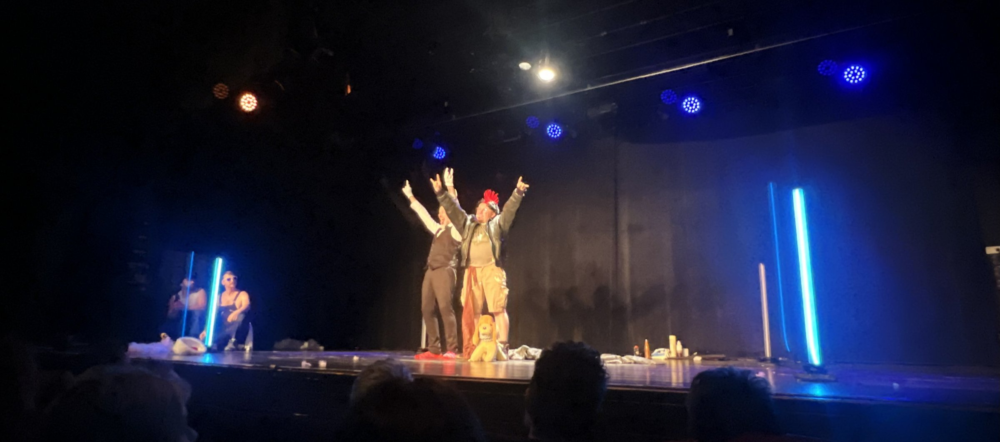
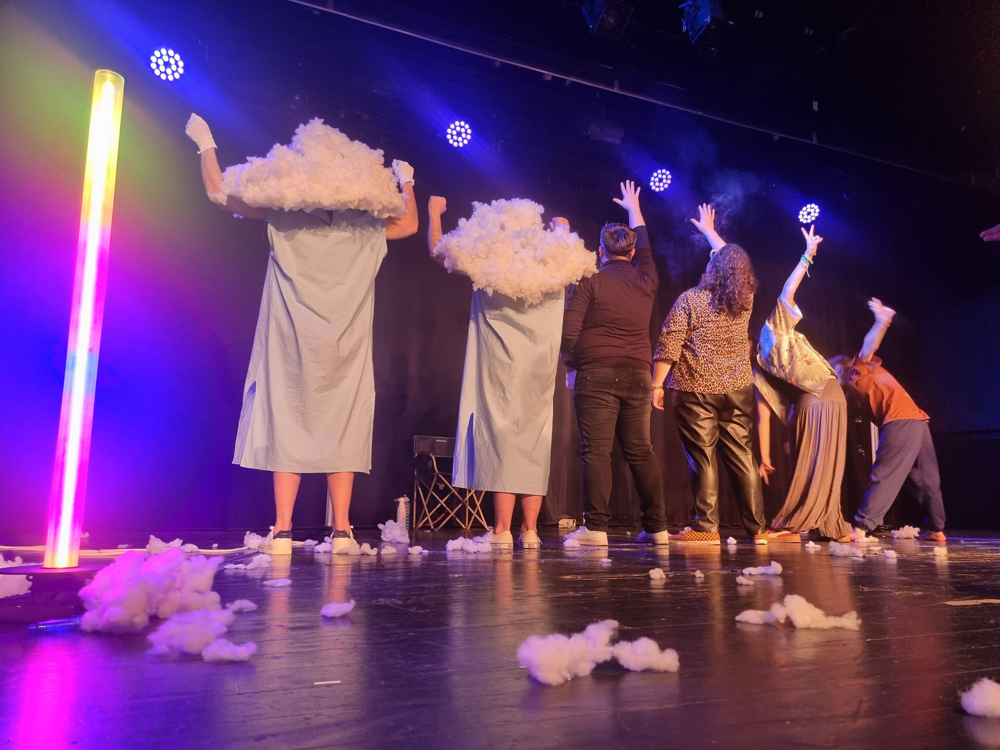
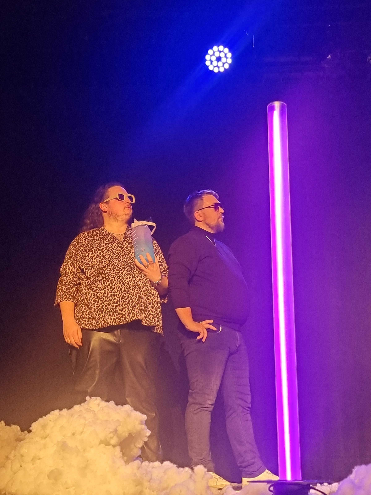

<!-- TODO(Clément): review the translation. -->

Every year, the Acides Animés improv troupe hosts its Catch Impro: pairs of characters face off in a wrestling-style ring, in front of a room of about 270 people. For the 2025 edition, I wanted the ring itself to become part of the staging.

Four light poles mark the corners of the ring. Controlled live from the booth, they change colour and effect as the matches unfold: team entrances, the tension of a scene, the audience vote.

The whole build (electronics, enclosures, programming) is documented in the DIY project [Light poles — version 1](/diy/poteaux-lumineux-v1).
