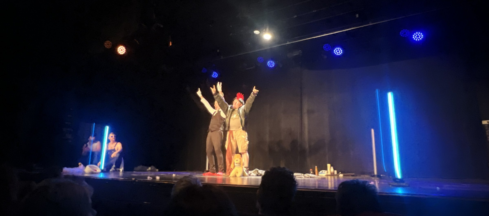
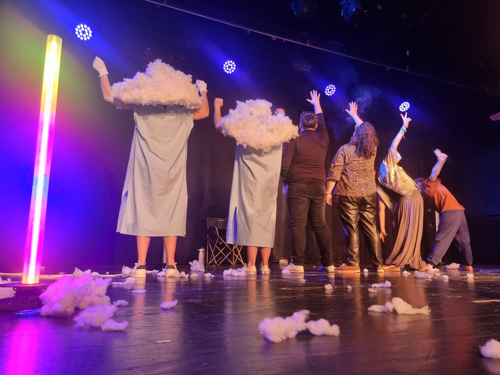
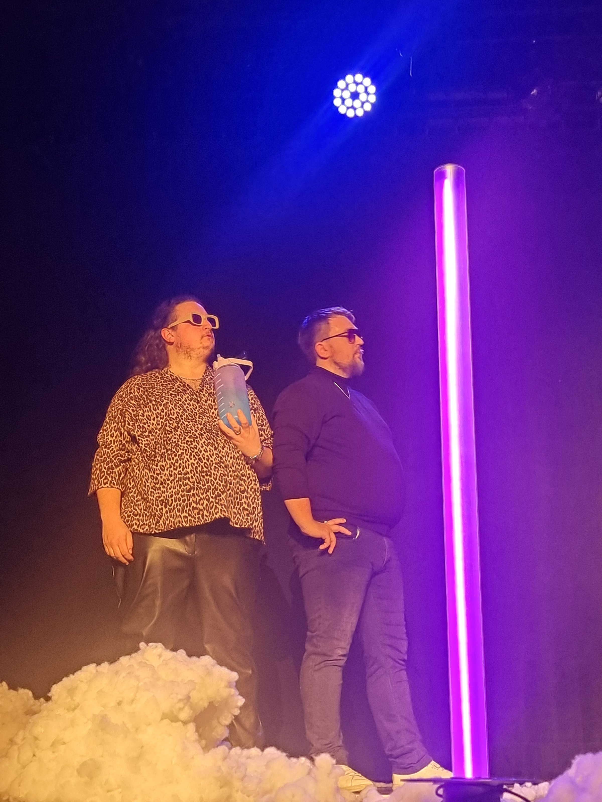

<!-- TODO(Clément) : relire et compléter le texte. -->

Chaque année, les Acides Animés organisent leur Catch Impro : des binômes de personnages s'affrontent dans un ring, devant une salle d'environ 270 personnes. Pour l'édition 2025, je voulais que le ring lui-même devienne un élément de mise en scène.

Quatre poteaux lumineux marquent les coins du ring. Pilotés en direct depuis la régie, ils changent de couleur et d'effet au fil des matchs : entrées des équipes, tension d'une scène, annonce du vote.

Toute la fabrication (électronique, boîtiers, programmation) est détaillée dans le projet DIY [Poteaux lumineux — version 1](/diy/poteaux-lumineux-v1).
