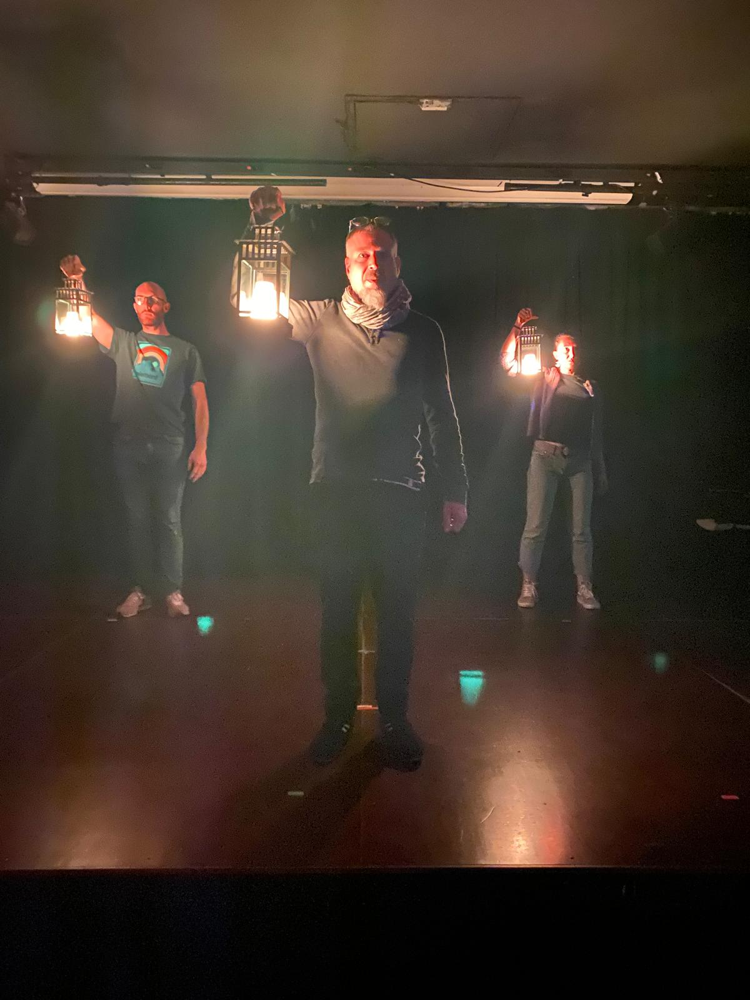
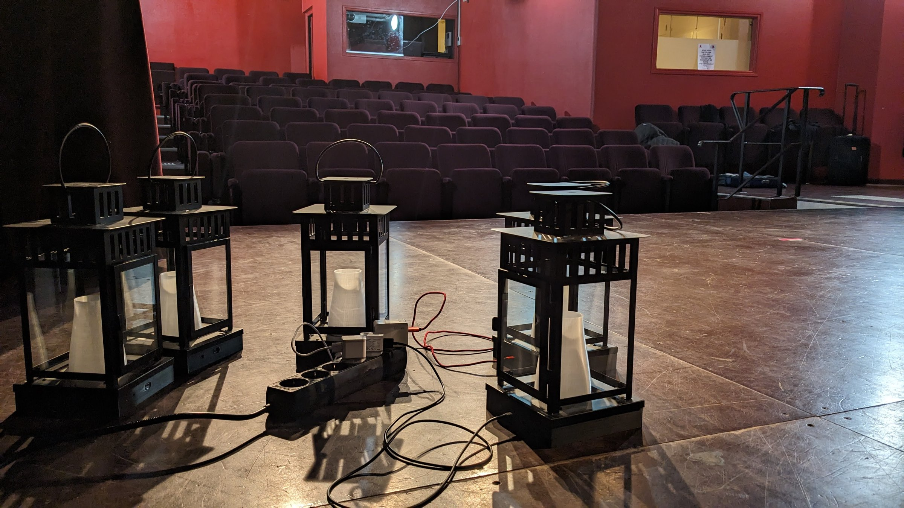

<!-- TODO(Clément): review the translation. -->

*Lueurs* ("Glimmers") is an improv theatre show where part of the light comes from the stage itself. Battery-powered, cable-free lanterns are carried, set down and moved by the performers, while their colour and intensity are controlled from the booth.



How the lanterns were designed and built is documented in the DIY project [LED lanterns](/diy/lanternes-leds).
