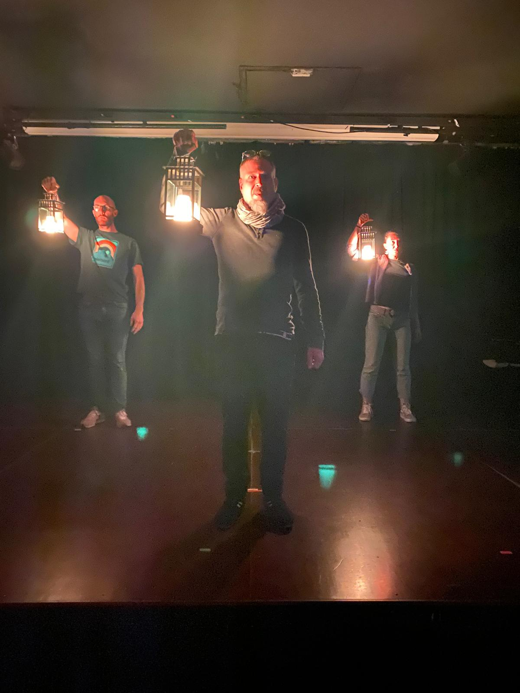
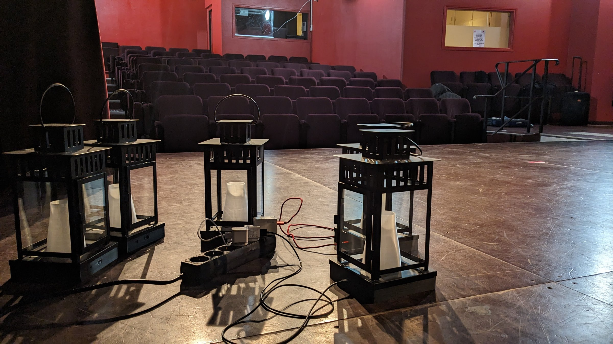

<!-- TODO(Clément) : relire, compléter (date, lieu, troupe) et ajouter des visuels. -->

*Lueurs* est un spectacle d'improvisation théâtrale dont la lumière vient en partie de la scène elle-même. Des lanternes sur batterie, sans aucun câble, sont portées, posées et déplacées par les comédien·nes, tandis que leur couleur et leur intensité sont pilotées depuis la régie.



La conception et la fabrication des lanternes sont détaillées dans le projet DIY [Lanternes LEDS](/diy/lanternes-leds).
