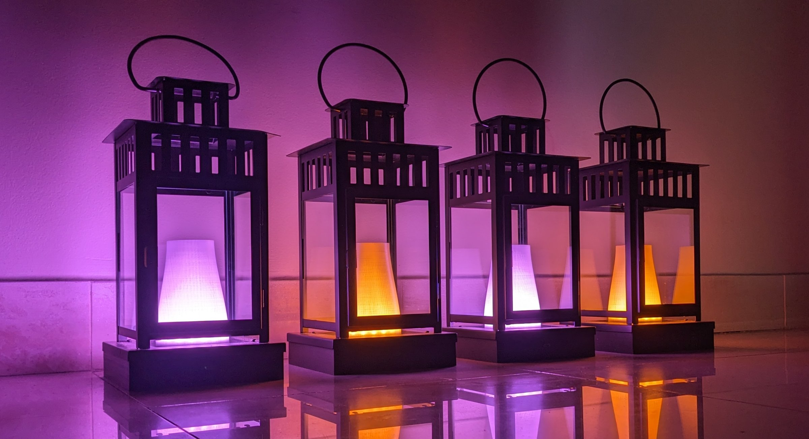

After the light poles project, and having discovered everything the WLED system can do, I was soon eager to explore other ways of lighting our improv theatre shows.

I quickly pictured a wireless setup, made possible by the ESP32 microcontroller and its built-in Wi-Fi antenna.

My first thoughts went to wearable lights, but I preferred to start with something simpler to build.

So I settled on lanterns.

Fairly understated and versatile, they can easily find a place in an improv concept, whereas an overly specific project would be hard to fit in.

## The requirements

Like any self-respecting project, the first thing to do is define what you actually need.

That helps you choose the right components and keeps you from heading off in every direction.

Here are the requirements I set myself:

- At least 3 hours of battery life (at full power)
- USB charging without taking anything apart
- Keep the look of a traditional lantern, so the electronics and the LED light go unnoticed
- A modest price, since it's paid for with the money of [Les Acides Animés](https://www.instagram.com/cieacidesanimes), my improv troupe.

## The design study

Before hunting for the lantern itself, I needed to find an electronic circuit that would fit and meet the requirements.

There's no point reinventing the wheel, and the world is full of clever people, so my first reflex was to search online for a similar project. If the maker also shares their resources, that's time saved on choosing components.

After quite a bit of searching, I found this project: [makerworld.com/fr/models/206688-wled-led-light-tube-battery-powered](http://makerworld.com/fr/models/206688-wled-led-light-tube-battery-powered)

The documentation provided already points towards components that seem to work for its use case, which looks more demanding than mine.

Perfect!

So I drew up a first schematic, ready for a first test.

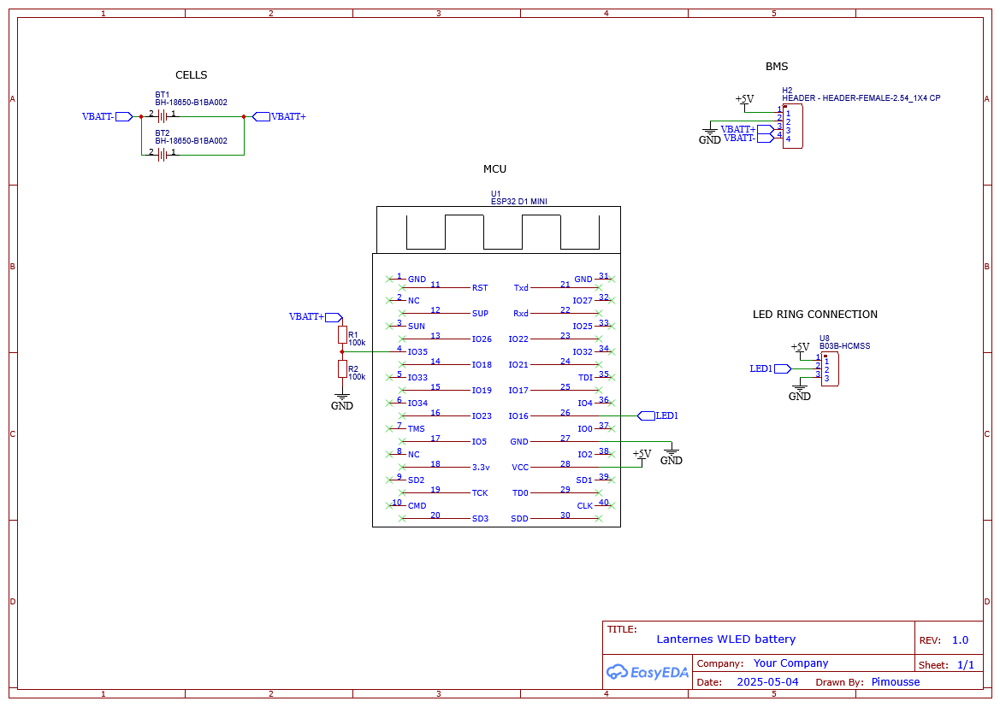

Note that in my schematic, I added a voltage divider on the IO35 input so the microcontroller can measure the battery voltage. That's information I could retrieve and use later.

Meanwhile, I looked for lanterns that could house all the electronics.

After some browsing on Leboncoin, I found some nice, rustic models full of character.

But I ran into two problems: the price, and I couldn't find 5 identical ones.

That's when I discovered that [IKEA sells some](https://www.ikea.com/fr/fr/p/borrby-lanterne-pour-bougie-bloc-interieur-exterieur-noir-10156109) for next to nothing: €9 (for the 28 cm version)...

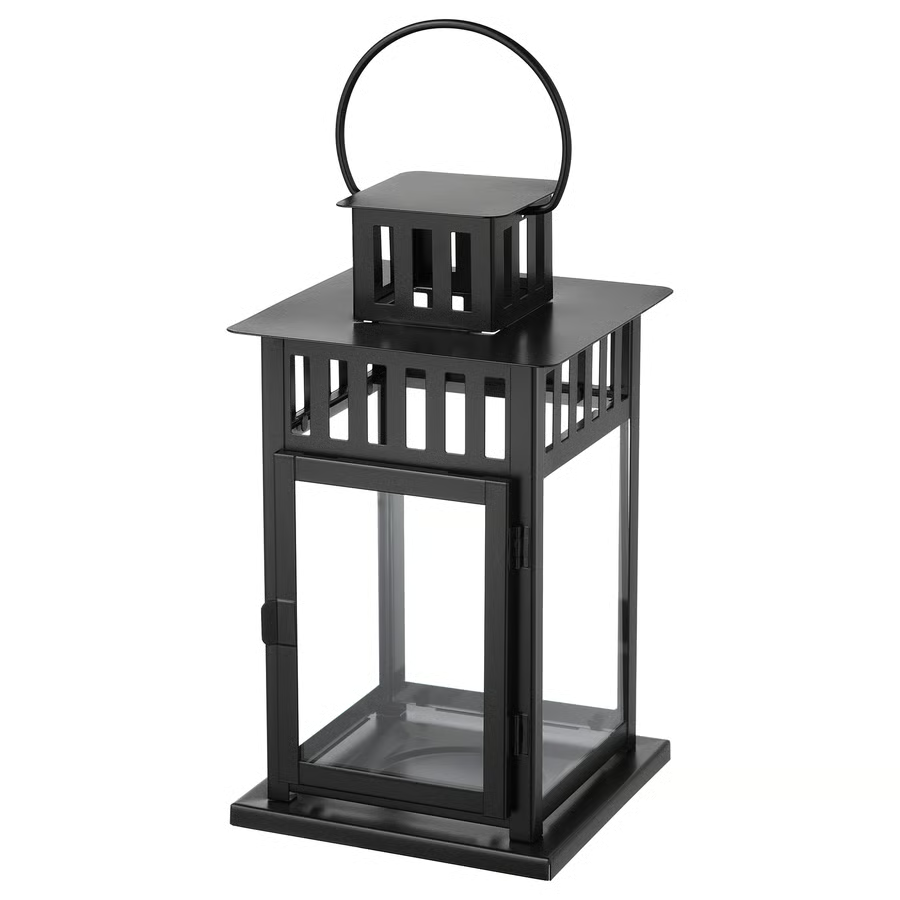

I ordered one to try it out.

## Proof of concept (POC)

I didn't yet know how many LEDs I'd need, how the light would be diffused, whether the Wi-Fi reception would be good, and a whole bunch of other unknowns...

There wasn't much choice: time to test!

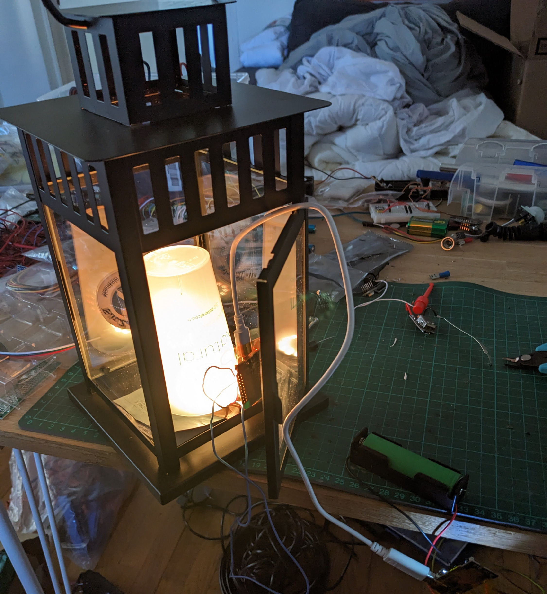

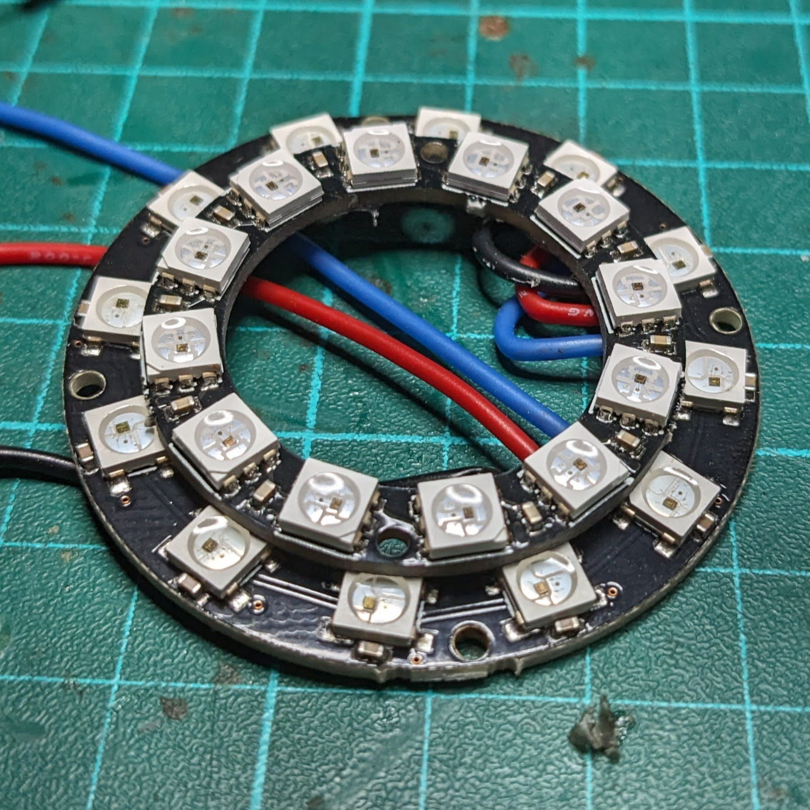

After realising that the whole system was misbehaving because of my cheap bench power supply (!), I finally got the lantern working with a battery and 2 LED rings quickly stuck in place, to judge the brightness with 24 LEDs.

It's good, but a bit more would be more comfortable (and I don't know how it will look on stage).

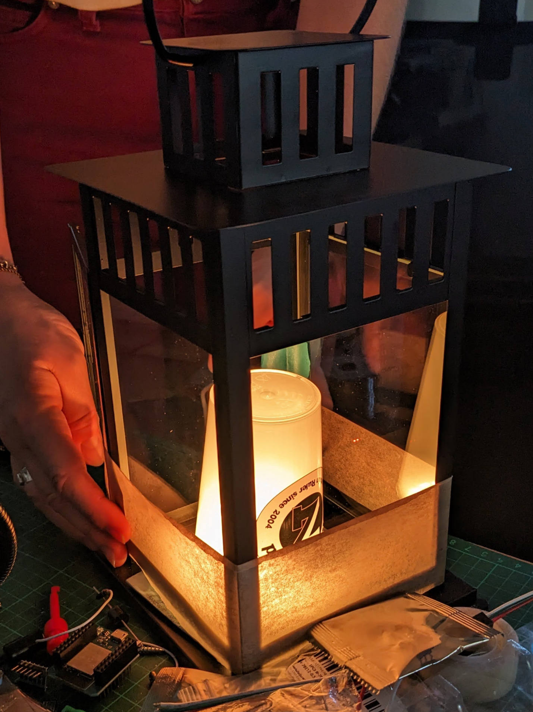

The diffusion idea comes from long evening drinks by the lake: once night falls, we switch on our phone torches and a few upturned reusable plastic cups act as diffusers.

I took inspiration from that make-do trick for my lantern.

I tried a few additions to hide the base and blur the individual dots of each LED, notably with a "frosted" paper that diffuses the light.

None of it looked good to me, so I'd work on the diffuser design to get rid of that unwanted effect.

## The prototype

### The electronics compartment

Now that everything seemed to work, it was time to move to CAD (computer-aided design) to fit all the electronics into the lantern, while respecting the most important requirement: every component must disappear so the lantern keeps its "natural" look.

After a few fit tests (still on the computer), I opted for a false bottom.

The advantage is that I'm free to lay out the components however I like, and the centre of gravity sits as low as possible, maximising the stability of the whole thing.

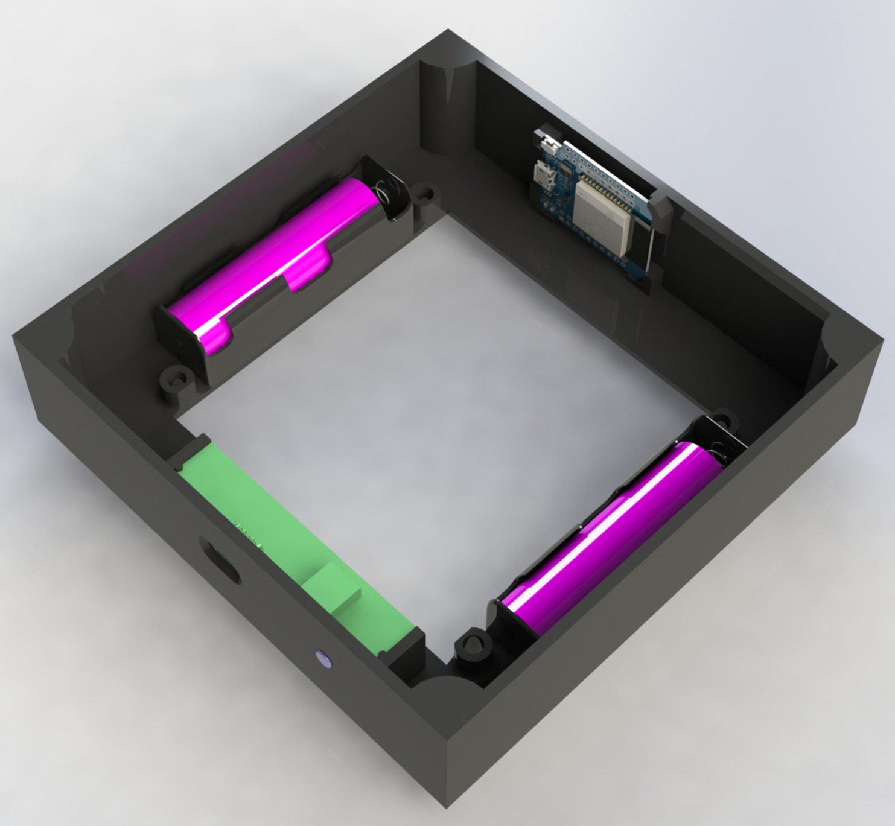

I redrew the components (or found ready-made models online), then designed the false bottom with a slot for each of them.

I positioned everything so the charging port is centred on one of the sides.

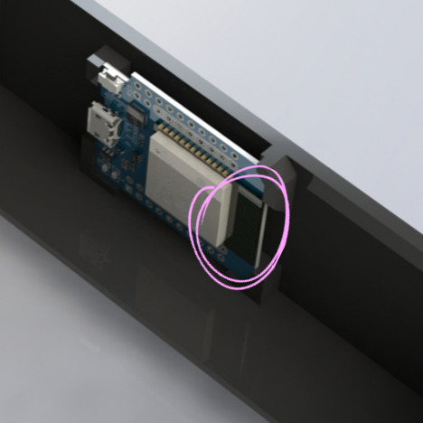

I also paid attention to where the microcontroller board and its onboard Wi-Fi antenna sit, to maximise Wi-Fi reception and minimise interference from the lantern's metal body.

Time to fire up the 3D printer and make the part!



### The light part

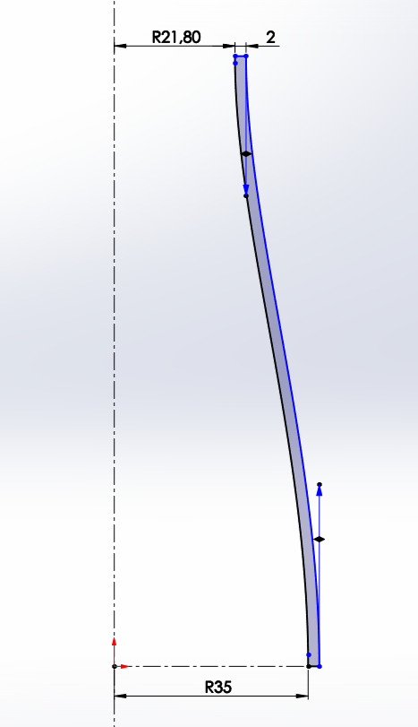

The idea is to take the cup trick and turn it upside down, but with reworked curves to capture as much of the light from the two LED rings as possible.

Soft curves guide the light evenly.

I tested 1 mm and 2 mm wall thicknesses, as well as different print settings (notably layer height and seam position).

Load the clear PETG into the printer and off we go!



Meanwhile, I took care of the WS2812 LED rings, for a total of 28 LEDs per lantern.

Each LED can be controlled individually in red, green and blue, although in our case they'll all be driven as one big LED.

Then a small 3D-printed part to clip the 2 rings together (and raise them to leave room for the wires), and job done!

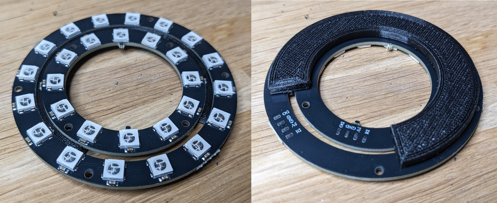

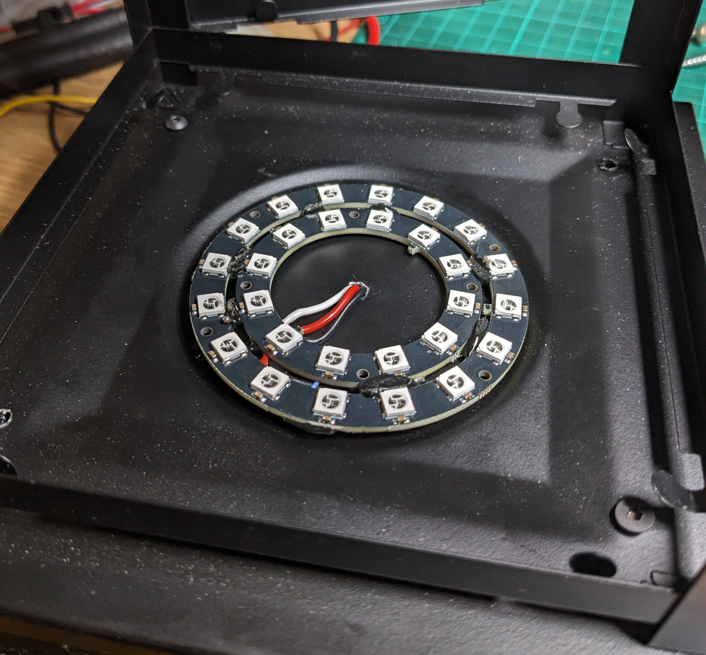

These rings are the perfect size for my project. Their outer diameter fits exactly into the part of the lantern originally meant for the candle, leaving just enough room for the diffuser.

It was important to concentrate the LEDs around the outside so that as much of the light as possible is caught by the diffuser.

Adding LEDs in the centre would only have lit the top of the lantern from the inside.

That wouldn't have looked good.

### Assembly and testing

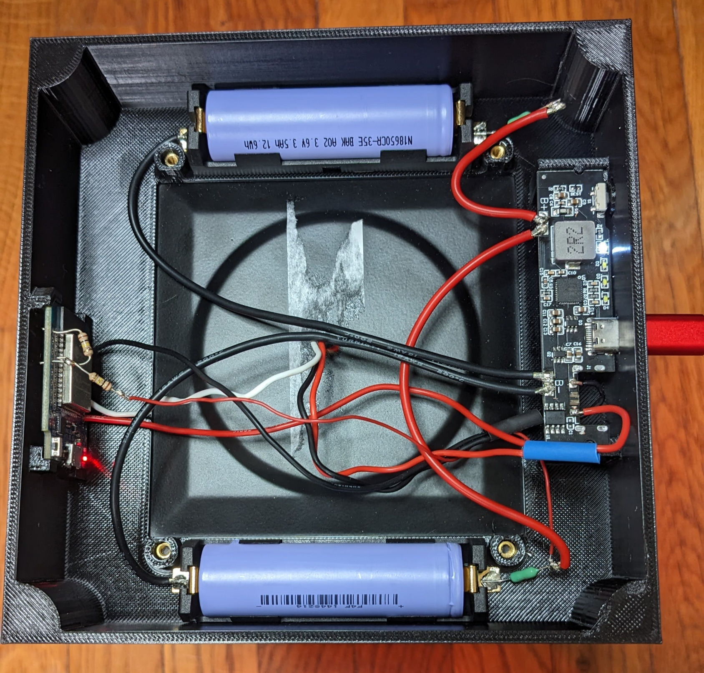

Soldering iron, hot glue gun, drill...

One tool after another, and after a few hours of assembly, the lantern was built.

I put the batteries (18650 lithium cells) in their holder and plugged in the USB cable.

It's charging!

All that was left was to press the power button and move on to the next step.

### Programming

As with the light poles project, I'm using [the WLED project](https://kno.wled.ge/) to drive my lanterns. More precisely, I'm using the [MoonModules](https://mm.kno.wled.ge/) project, which builds on WLED with extra features... that turned out to be handy for this project!

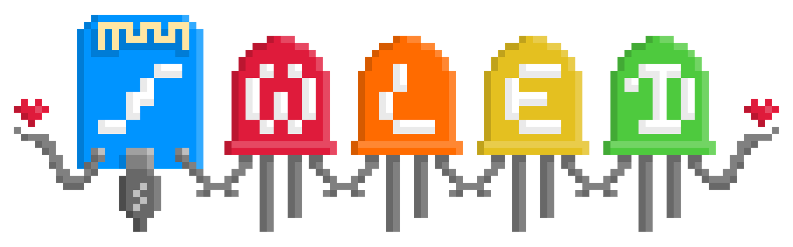

After a fair amount of trial and error with the [online compiler](https://wled-compile.github.io/), I generated a custom firmware that works and includes the features I need (notably battery management and the MQTT protocol).



With the microcontroller flashed, I switched on the lantern and took control of it through the web interface to configure it.

Everything worked perfectly: the brightness is sufficient, and the shape of the diffuser channels the light so that it visually gathers in the middle along its height, giving the flame-like effect I was after.

Combined with WLED's "Candle" effect, it really looks like a genuine candle behind the diffuser.

The prototype was ready, so on to mass production (that is, 4 more :D ).

## The production setup

### Network infrastructure

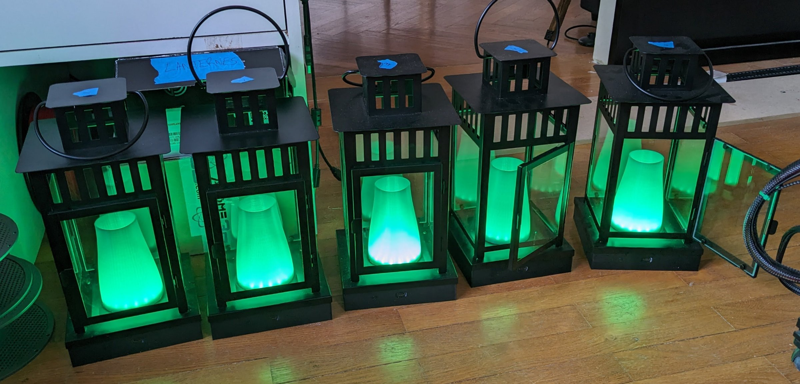

After a few minor mishaps (faulty components, an undersized fuse, etc.), all 5 lanterns were finally working.

Next, I had to prepare the environment they'd be used in for the show.

Portable lanterns mean one thing that makes any lighting technician sweat: wireless connectivity — and more specifically, in our case, Wi-Fi!

Wi-Fi mostly runs on the 2.4 GHz band, and the lanterns' microcontrollers can only communicate on that band anyway.

But that band is also shared with Bluetooth devices and amateur radio, and sits right next to the frequency used by microwave ovens (2.45 GHz)...

In short, it's a crowded space, and with a venue holding nearly a hundred people and as many smartphones, the air is full of interference of every kind!

The link had to be made as secure as possible so the lighting desk stays in control of the lanterns on stage at all times.

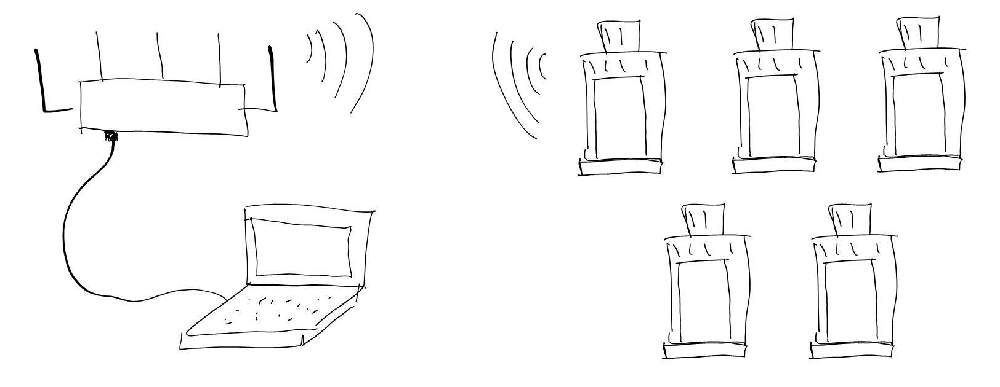

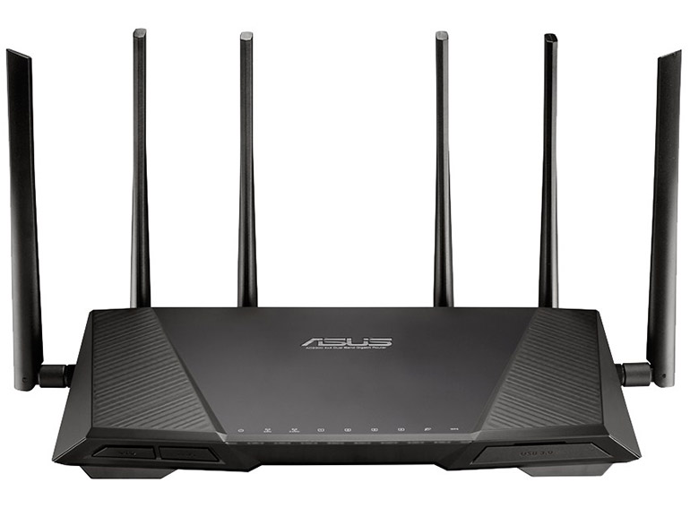

For the Wi-Fi connection, I'm using the same router as in the light poles project.

However, experience showed that it needed to be as close as possible — on stage, or failing that, very nearby (again, so that there's as little interference as possible between the router and the lanterns, namely the audience's phones).

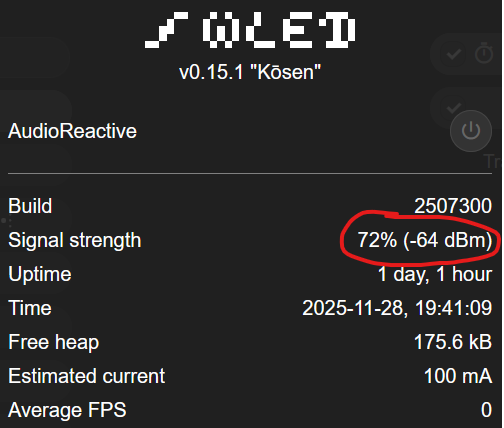

WLED provides a whole host of data and statistics, so I connected to each lantern with a web browser to check the quality of the Wi-Fi signal.

As it turned out, on stage I get around 80% closest to the router and 65% at the farthest point.

Pretty satisfying.

For the geeks among you: each lantern has its own IP address on a /24 network, which lets the lighting software control them via [broadcast](https://en.wikipedia.org/wiki/Broadcasting_(networking)) using the [Art-Net](https://en.wikipedia.org/wiki/Art-Net) communication protocol.

### Programming on the lighting desk PC

Beautiful lanterns are all well and good, but they're on stage first and foremost to enhance a moment, an artistic idea. So they have to be brought to life.

And that's the lighting desk's job.

But we're a small troupe of actors with no permanent technician. Anyone might end up running the lights on a given night.

So we need a system that's simple and intuitive to use (and cheap, once again).

I've been working with [QLC Plus](https://www.qlcplus.org/) for 8 years now.

Free, open source and backed by an active community, it supports a wide range of protocols, including the one we need for our lanterns: Art-Net.

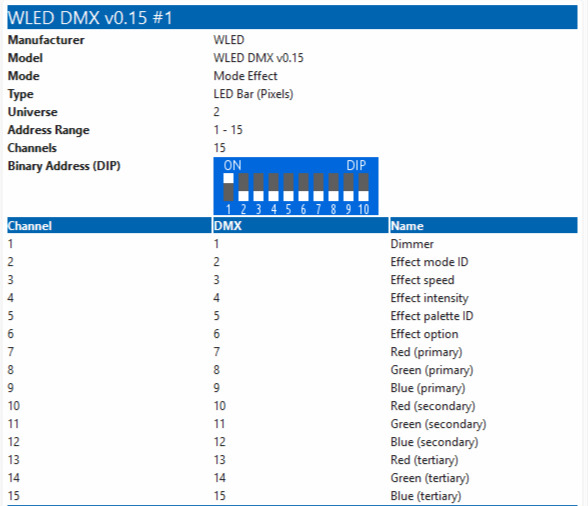

I reused the profile I'd created for the light poles.

I simply had to duplicate it to get 5 fixtures, one per lantern.

The DMX start address and Art-Net universe are set in each lantern's web app.

This QLC Plus fixture profile [has been submitted to the community](https://www.qlcplus.org/forum/viewtopic.php?t=18472) for inclusion in the next update.

To control the software intuitively, I use an AKAI APC Mini MK2 controller.

Available for €80–90, this little box packed with colour-configurable buttons is fully compatible with QLC Plus and gives you incredible freedom to build a custom interface for the operator.

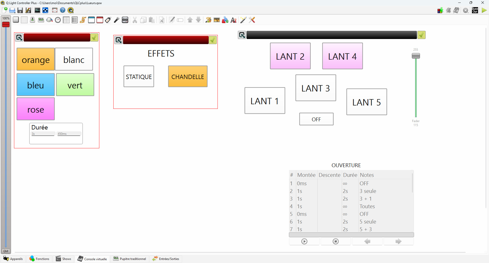

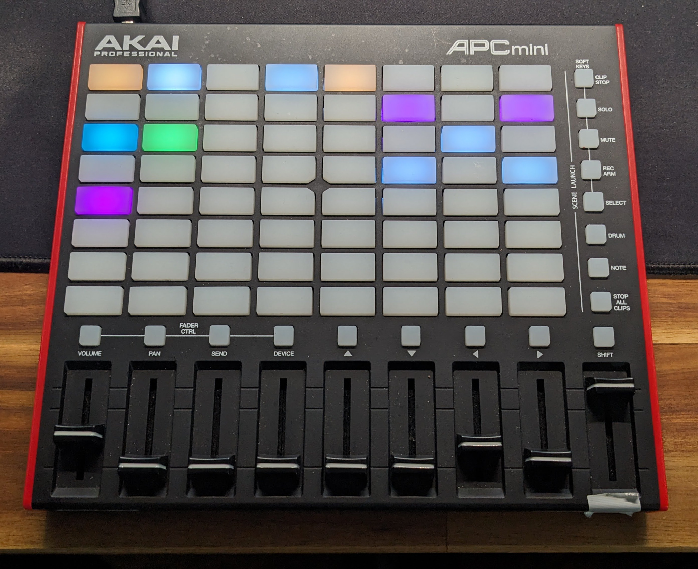

Of course, the rest of the venue's lighting rig could also be run from the same software, but that would mean a lot of programming and re-cabling for every performance. The idea is to keep the venue's setup as it is and not make the operator's job any harder, always with the aim of keeping it as accessible as possible.

## The result

Obviously I can't give an exhaustive rundown of all the staging in the show *Lueurs*, which uses these lanterns.

Still, here are a few visuals to give all this work some meaning.

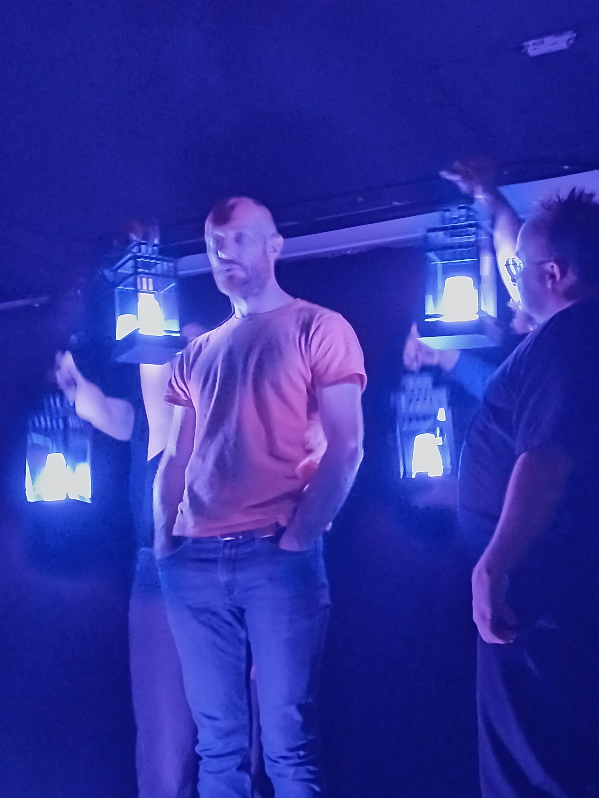

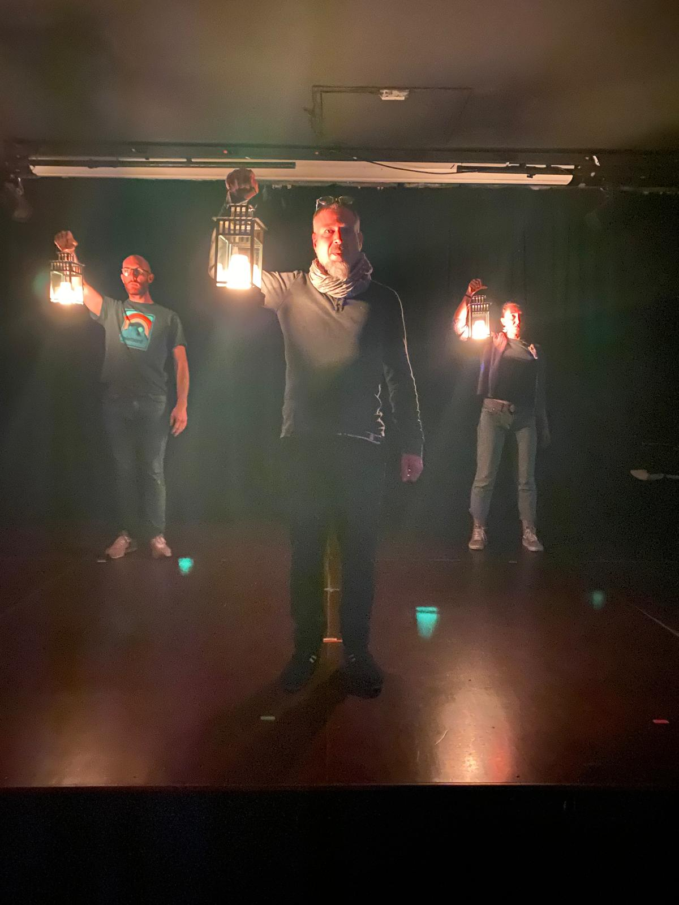

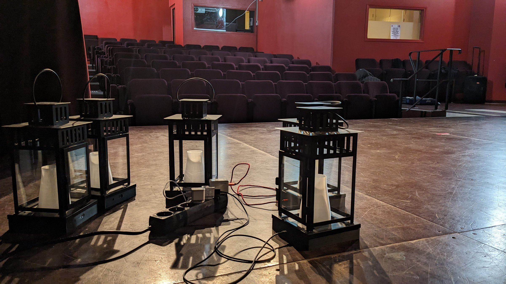


