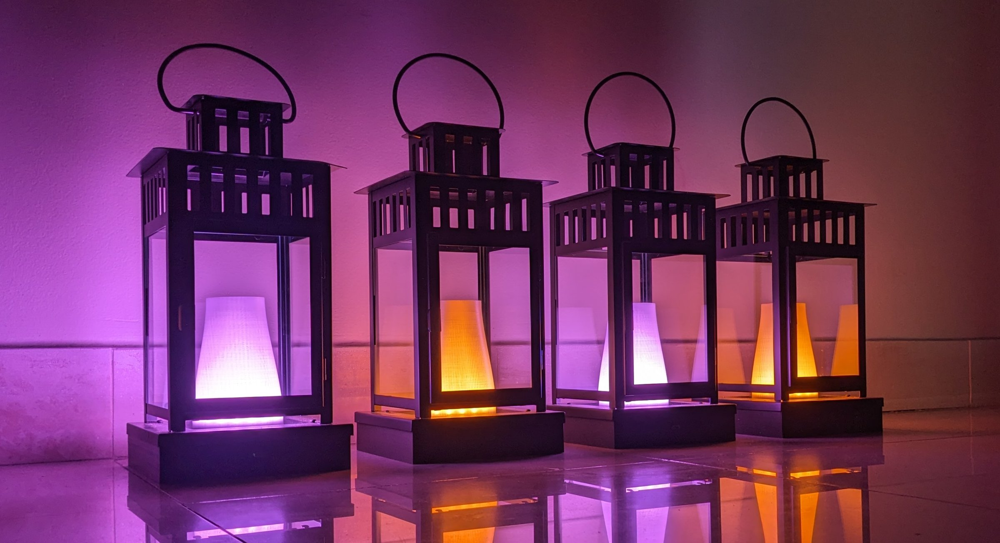

Après le projet des poteaux lumineux, et avoir découvert les possibilités que peut offrir le système WLED, j'ai très vite voulu creuser d'autres façons de mettre en lumière nos spectacles d'improvisation théâtrale.

J'ai très vite imaginé une utilisation non câblée, rendue possible par l'utilisation du microcontrôleur ESP32 pourvu d'une antenne Wifi.

Si mes premières pensées ont portés sur des lumières portées sur soi (wearable), j'ai préféré commencé avec une forme plus simple à mettre en œuvre.

Mon choix s'est donc arrêté sur des lanternes.

Assez sobres et versatiles, elles pourront trouver leur place facilement dans un concept d'impro, là où un projet trop spécifique serait difficile à intégrer.

## Le cahier des charges

Comme tout bon projet qui se respecte, il est important avant toute chose de définir ce dont on a besoin.

Cela permettra de choisir les bons composants et de ne pas se disperser dans tous les sens.

Voici le cahier des charges que je me suis fixé :

- Une autonomie d'au moins 3h (à pleine puissance)
- Une recharge possible par USB sans démontage
- Conserver l'esthétique d'une lanterne traditionnelle, en faisant oublier l'électronique et la lumière LED
- Un prix contenu car c'est payé avec l'argent des [Acides Animés](https://www.instagram.com/cieacidesanimes), ma troupe d'impro.

## L'étude

Avant de se lancer dans la recherche de la lanterne elle-même, il s'agit de trouver un circuit électronique qui convienne et qui satisfasse le cahier des charges.

Comme il est inutile de réinventer la roue et que le monde regorge de petits génies, mon premier réflexe est de faire des recherches sur internet pour éventuellement trouver un projet similaire. Si en prime, le/la créateur.ice partage ses ressources, ce sera alors du temps de gagné sur la sélection des composants.

Après pas mal de recherches, je découvre le projet suivant : [makerworld.com/fr/models/206688-wled-led-light-tube-battery-powered](http://makerworld.com/fr/models/206688-wled-led-light-tube-battery-powered)

La documentation fournit permet déjà de s'orienter vers des composants qui semblent fonctionner pour son utilisation qui semble plus contraignante que la mienne.

Parfait !

J'ai donc réalisé un premier schéma, prêt pour un premier test.

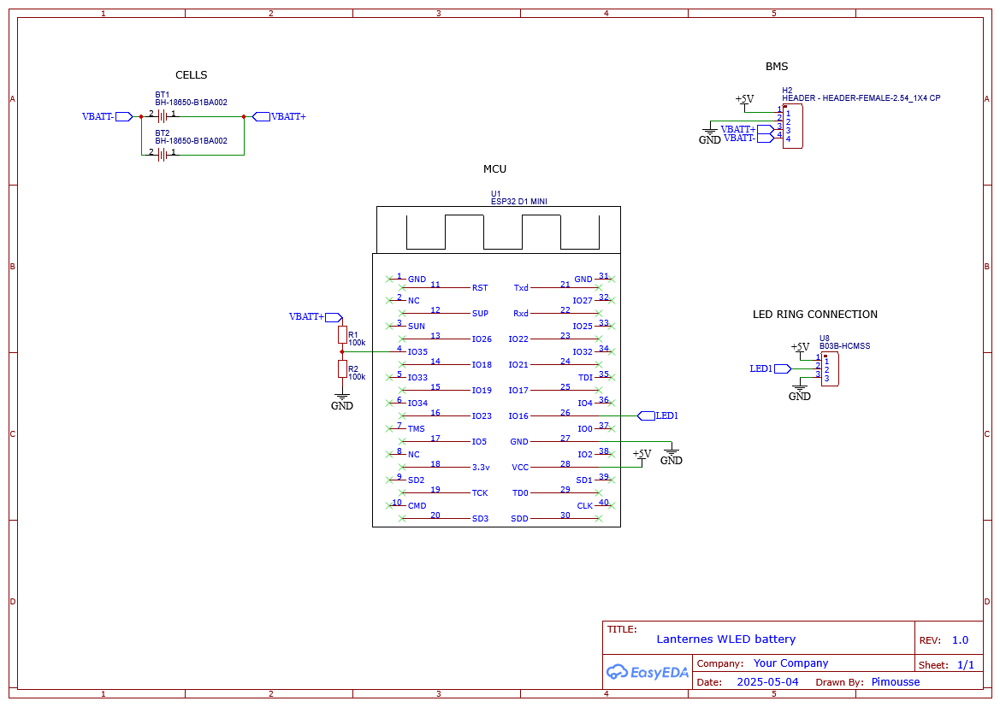

A noter que dans mon schéma, j'ajoute un pont diviseur de tension sur l'entrée IO35 qui permet de mesurer la tension de la batterie par le micro-contrôleur. Une info que je pourrais récupérer et traiter plus tard.

En parallèle, j'ai recherché les lanternes qui pourraient recevoir toute l'électronique.

Après quelques recherches sur Leboncoin, je trouve des modèles sympas, rustiques, avec du cachet.

Mais je me heurte à deux problèmes : le prix et je n'en trouve pas 5 identiques.

C'est alors que je découvre que [IKEA en vend](https://www.ikea.com/fr/fr/p/borrby-lanterne-pour-bougie-bloc-interieur-exterieur-noir-10156109) à un prix dérisoire : 9€ (en version 28cm)...

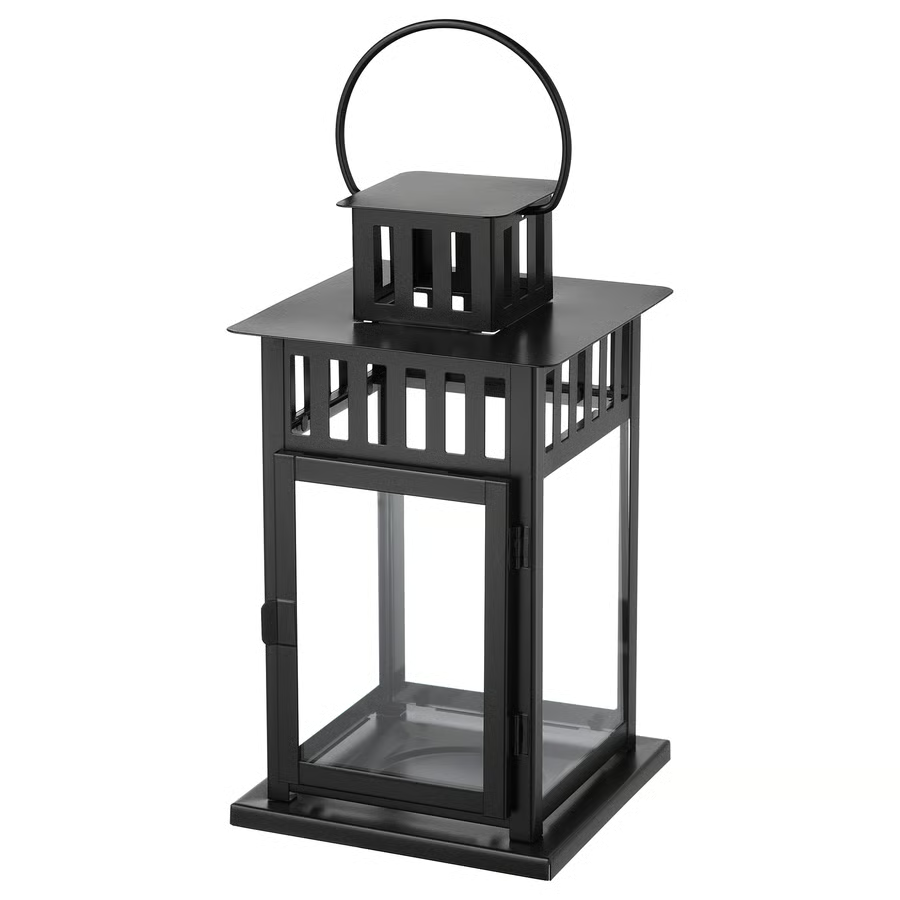

J'en commande une pour essayer.

## La preuve de concept (POC)

Je ne sais pas encore combien de LEDS il me faudra, comment la lumière sera diffusée, si la réception Wifi sera bonne et tout un tas d'inconnus...

Il n'y a pas beaucoup de choix : il faut tester !

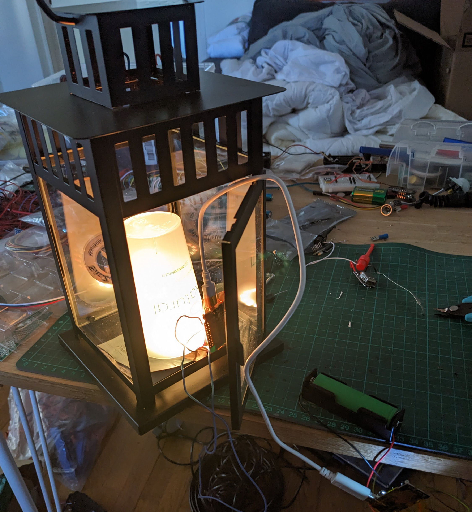

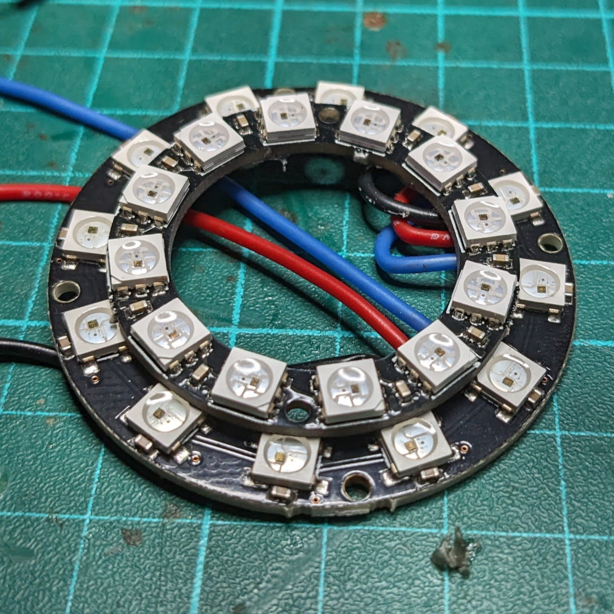

Après m'être rendu compte que tout le système dysfonctionnait à cause de mon alimentation de laboratoire bas de gamme (!), j'ai enfin pu faire fonctionner la lanterne avec une pile et 2 anneaux de LEDS collés rapidement pour juger de la luminosité avec 24 LEDS.

C'est bien mais un peu plus serait plus confortable (et je ne sais pas comment cela peut rendre sur scène).

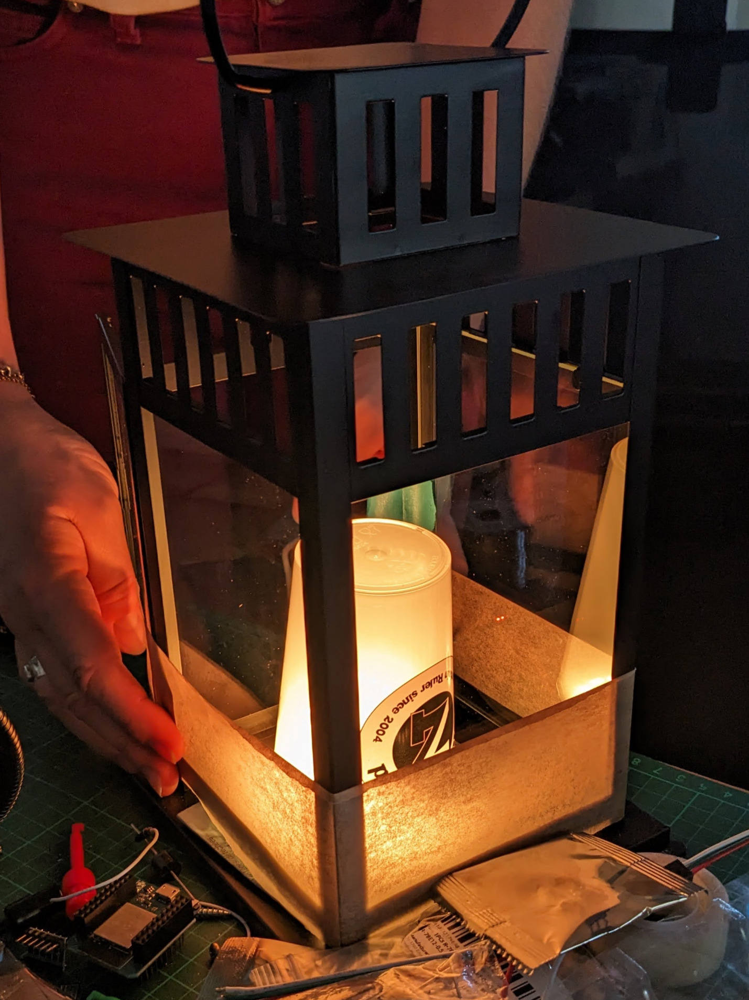

La diffusion, quant à elle, s'inspire de longs apéros au bord du lac : une fois la nuit tombée, on allume les torches des téléphones et quelques écocups retournées font office de diffuseur.

Je m'inspire de ce système D pour ma lanterne.

Je tente quelques additions afin de cacher la base et dissimuler les points que l'on distingue pour chaque LED, notamment avec un papier "givré" qui diffuse la lumière.

Rien ne me plait esthétiquement, je travaillerai le design du diffuseur pour gommer cet effet indésirable.

## Le Prototype

### Le compartiment électronique

Maintenant que tout semble fonctionner, il est temps de passer à la CAO (Conception Assisté par Ordinateur) afin d'intégrer toute l'électronique dans cette lanterne, tout en respectant le point le plus important du cahier des charges : tous les composants doivent se faire oublier afin de conserver l'aspect "naturel" de la lanterne.

Après quelques tests d'intégration (toujours par ordinateur), j'opte pour la création d'un double fond.

L'avantage est que je suis libre pour la disposition des composants et que le centre de gravité se trouvera le plus bas possible, maximisant la stabilité de tout l'ensemble.

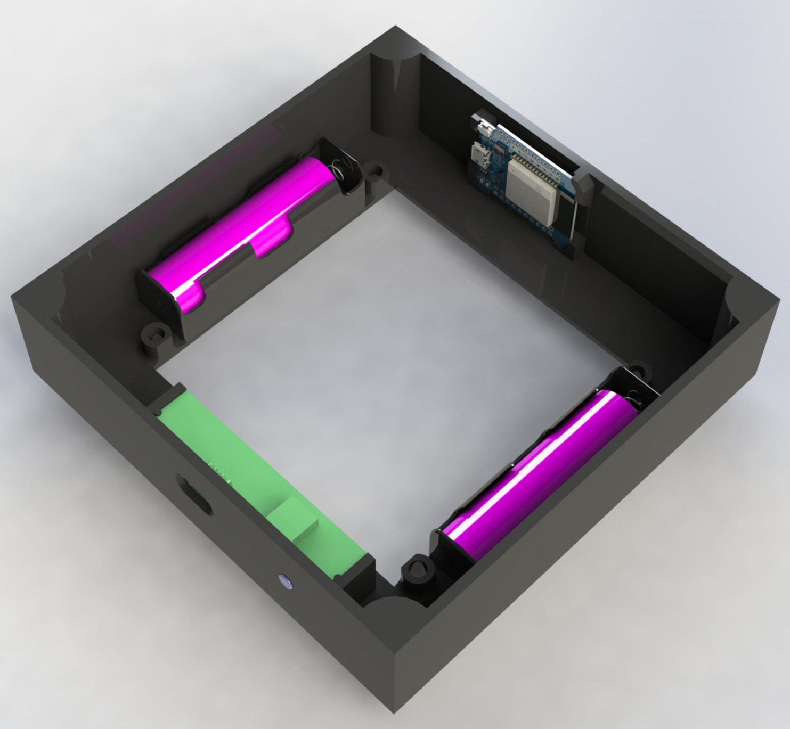

Je redessine (ou trouve déjà faits sur internet) les composants puis je crée le double fond avec leurs emplacements.

Je positionne le tout pour que le port de charge soit centré sur une des faces.

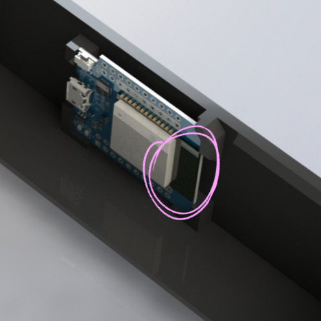

Je fais aussi attention à la position de la carte du microcontrôleur et son antenne Wifi embarquée pour maximiser la réception Wifi et être le moins impactée par la masse métallique de la lanterne.

Il est temps d'allumer l'imprimante 3D et de créer la pièce !



### La partie lumineuse

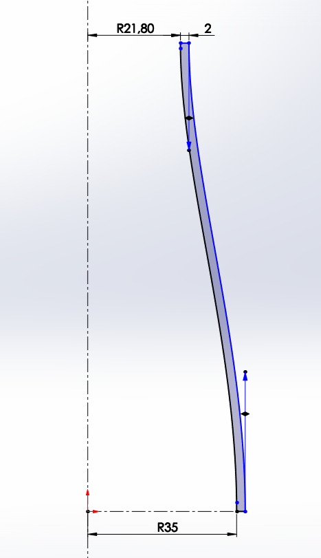

L'idée est de reprendre l'idée de l'écocup à l'envers mais en retravaillant les courbes pour capturer un maximum de  lumière émise par les deux anneaux de LEDS.

Des courbes douces permettront d'accompagner la lumière uniformément.

Je fais des tests en 1mm et 2mm d'épaisseur ainsi que différents paramètres d'impression (épaisseur et jointure de couche notamment).

On charge le plastique PETG transparent dans l'imprimante et c'est parti !



Pendant ce temps, je m'occupe des anneaux de LEDS WS2812 pour un total de 28 LEDS par lanterne.

Chaque LED est contrôlable individuellement en rouge, vert et bleu, même si dans notre cas, elles seront toutes gérées comme une seule grosse LED.

Hop, une petite pièce imprimée 3D pour clipser les 2 anneaux entre eux (et les surélever pour laisser la place aux fils) et le tour est joué !

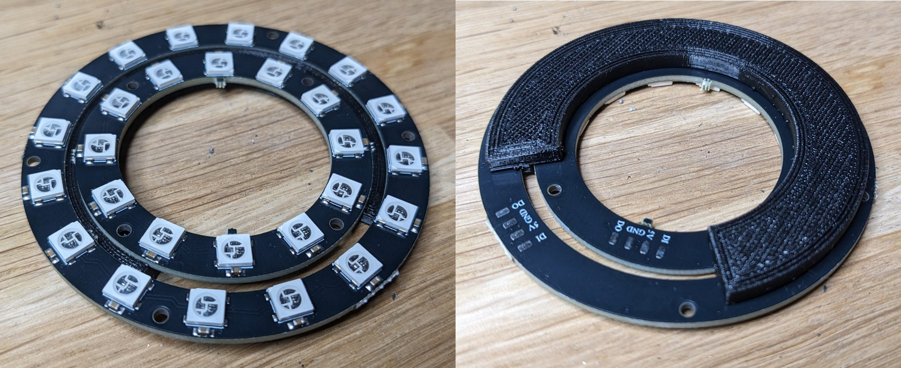

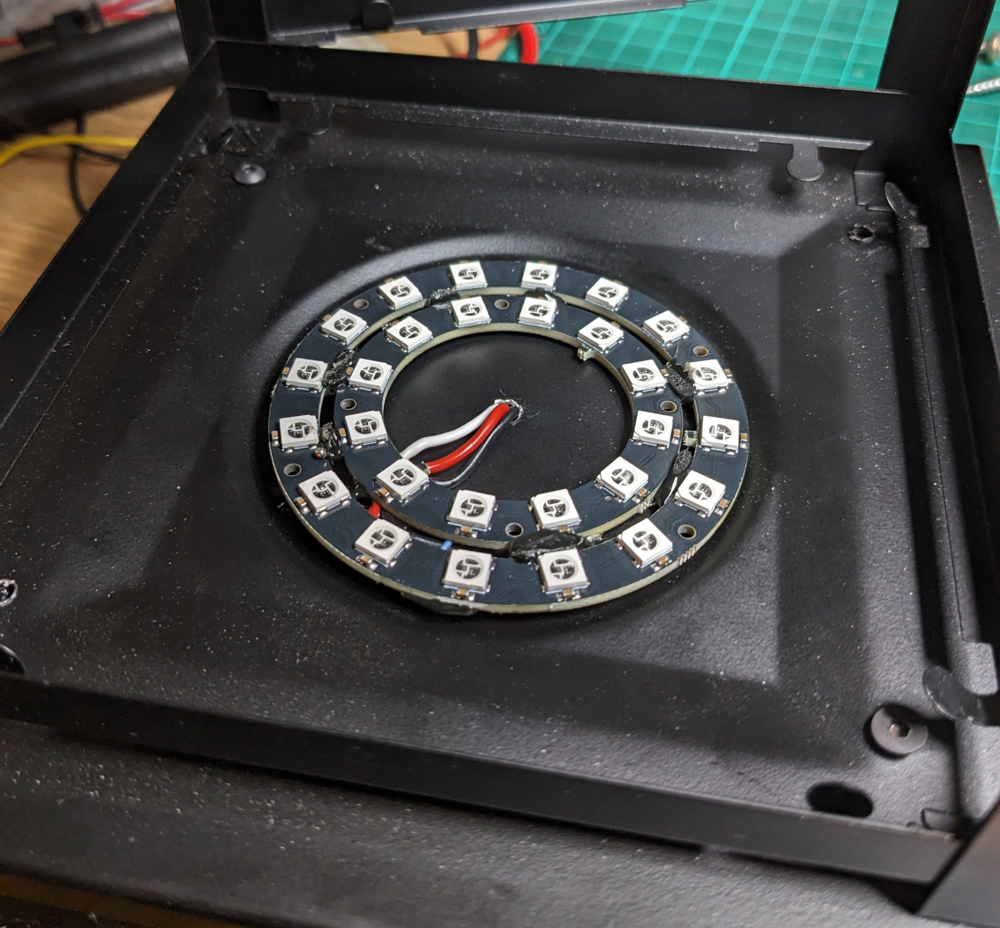

La taille de ces anneaux est parfaite pour mon projet. Le diamètre extérieure tombe pile dans la partie de la lanterne dédiée initialement à la bougie et il reste juste ce qu'il faut pour le diffuseur.

Il était important de concentrer les LEDS sur l'extérieur afin qu'un maximum du flux lumineux soit capté par le diffuseur.

Ajouter des LEDS au centre n'aurait finalement qu'éclairer le haut de la lanterne par l'intérieur.

Cela n'aurait pas été esthétique.

### Assemblage et tests

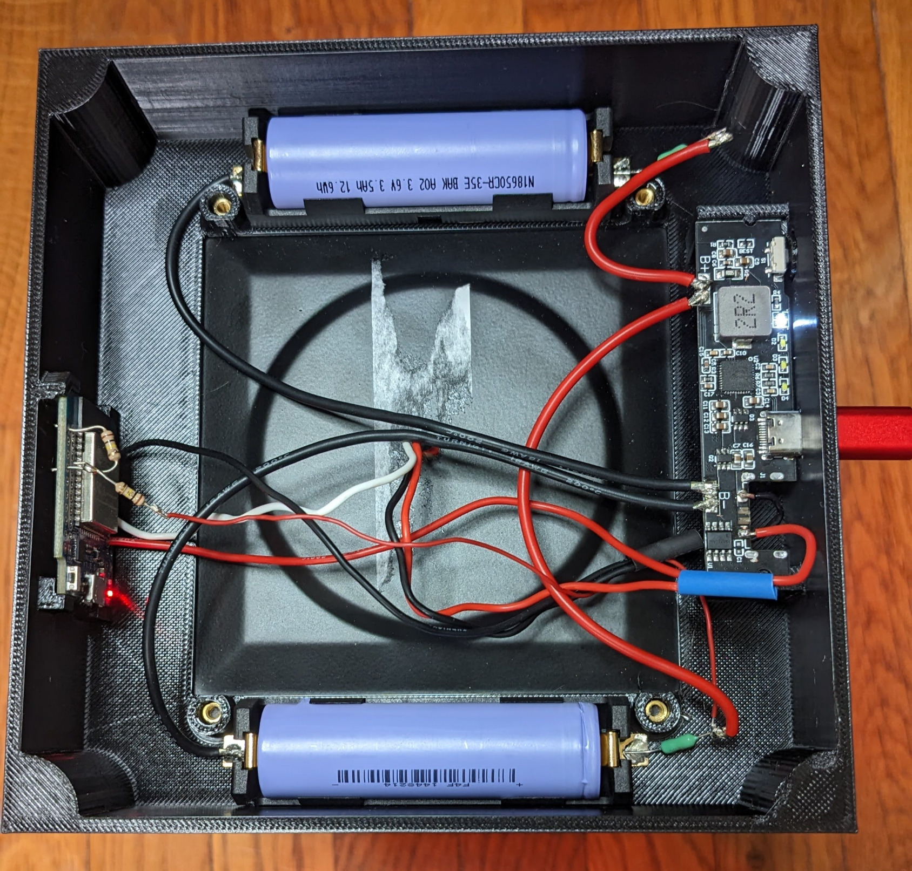

Fer à souder, pistolet à colle chaude, perceuse...

Les outils se succèdent et après quelques heures d'assemblage, la lanterne est montée.

J'installe les batteries (piles lithium 18650) dans leur logement et je branche le câble USB.

Ca charge !

Il ne reste plus qu'à appuyer sur le bouton d'allumage et passer à l'étape suivante.

### La programmation

Comme pour le projet des poteaux lumineux, je vais utiliser [le projet WLED](https://kno.wled.ge/) pour piloter mes lanternes. Plus précisément, je vais utiliser le projet [MoonModules](https://mm.kno.wled.ge/) qui reprend le projet WLED mais avec davantage de fonctionnalités... qui vont m'être utiles pour ce projet !

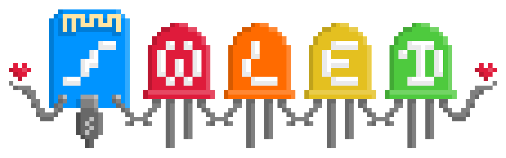

Après avoir pas mal tâtonné avec le [compilateur en ligne](https://wled-compile.github.io/), je génère un firmware spécifique qui fonctionne et embarque les fonctionnalités qu'il me faut (notamment la gestion de la batterie et protocole MQTT).



Le microcontrôleur est chargé, j'allume la lanterne et en prend le contrôle avec l'interface web pour la configurer.

Tout fonctionne parfaitement, la luminosité est suffisante et le diffuseur, par sa forme, conduit la lumière en la concentrant visuellement au centre sur sa hauteur procurant un effet de flamme comme je le désirais.

Combiné à l'effet "Candle" de WLED, on a vraiment l'impression qu'il s'agit d'une authentique bougie derrière le diffuseur.

Le prototype est prêt, on peut passer à la production de masse (soit 4 autres :D ).

## Le setup de production

### Infrastructure réseau

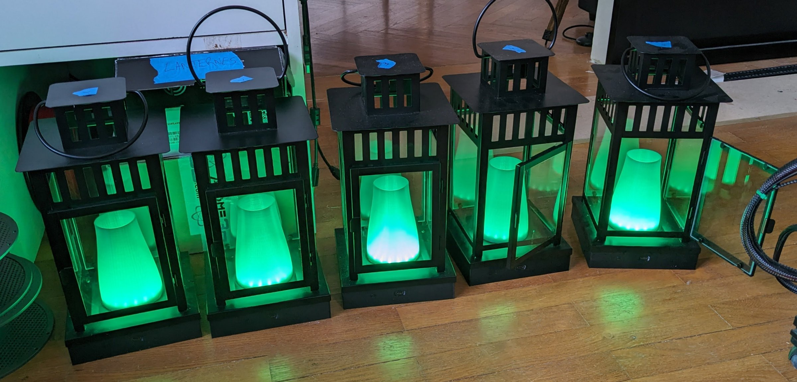

Après quelques petites mésaventures (composants dysfonctionnels, mauvais dimensionnement de fusible, etc.), les 5 lanternes sont finalement fonctionnelles.

Il s'agit maintenant de préparer l'environnement dans lequel elles seront utilisées pour le spectacle.

La portabilité des lanternes implique une chose qui fait transpirer un régisseur : la connectivité sans fil et plus précisément dans notre cas : le Wifi !

Le Wifi est principalement utilisé sur la bande de fréquence 2,4Ghz et les microcontrôleurs des lanternes ne peuvent d'ailleurs communiquer que sur cette bande.

Or cette bande de fréquence est aussi partagée avec les équipements Bluetooth ou autres radio-amateurs et se trouve juste à côté de la bande de fréquence des fours à micro-ondes (2,45Ghz)...

Bref, y'a du monde qui cause et avec une salle de spectacle composée de près d'une centaine de personnes avec autant de smartphones, l'environnement est pollué d'ondes en tout genre !

Il va falloir sécuriser au maximum la communication afin que la régie garde le contrôle à tout instant des lanternes sur scène.

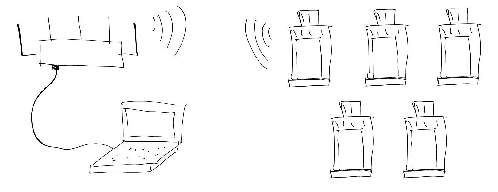

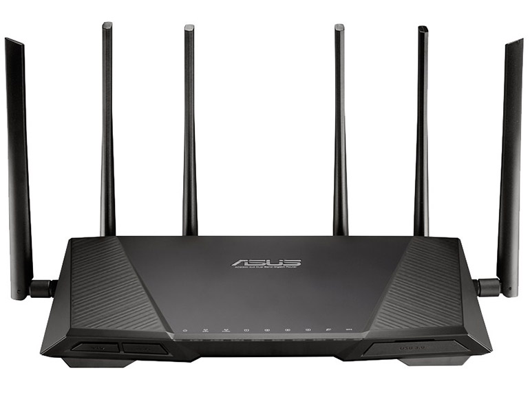

Pour la connexion Wifi, je vais prendre le même routeur que j'ai utilisé pour le projet des poteaux lumineux.

Cependant, l'expérience a montré qu'il fallait le mettre au plus près, soit sur scène ou à défaut, très proche (toujours dans l'idée qu'entre le routeur et les lanternes, il y ait le moins de pollution possible, à savoir les téléphones du public).

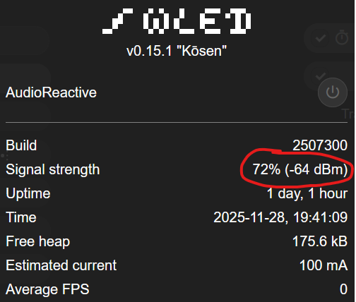

Le système WLED offre tout un tas de données et statistiques, je me connecte donc avec un navigateur web à chacune des lanternes pour analyser la qualité de réception du signal Wifi.

L'avenir montrera que sur scène, j'obtiens environ 80% au plus proche du routeur et 65% au plus éloigné.

Plutôt satisfaisant.

Pour les plus geeks, chaque lanterne a son adresse IP en /24 ce qui permettra de les contrôler en [brodcast](https://fr.wikipedia.org/wiki/Broadcast_(informatique)) par le logiciel de gestion lumière via le protocole de communication [Art-Net](https://fr.wikipedia.org/wiki/Art-Net).

### La programmation sur le PC régie

C'est bien beau d'avoir de belles lanternes, mais elles sont avant tout sur scène pour sublimer un moment, une proposition artistique. Il faut donc leur donner vie.

Et c'est la régie lumières qui va s'en charger.

Or, nous sommes une petite troupe de comédien.nes, nous n'avons pas de régisseur permanent. Tout le monde peut être amené à être l'opérateur lumière du soir.

Il faut donc un système simple d'utilisation et intuitif (et pas cher, encore une fois).

Cela fait déjà 8 ans que je travaille avec le logiciel [QLC Plus](https://www.qlcplus.org/).

Gratuit, open source, avec une communauté active, il offre une connectivité étendue à plein de protocoles dont celui qui nous intéresse pour nos lanternes : Art-Net.

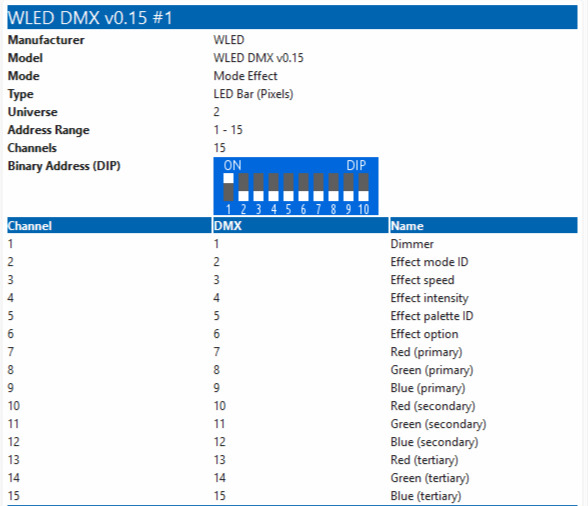

Je réutilise le profil créé pour les poteaux lumineux.

Il me suffit simplement de le dupliquer pour avoir 5 fixtures, un par lanterne.

L'adresse de départ DMX et l'univers Artnet sont configurés dans l'application web de chaque lanterne.

Ce fichier fixture profile QLC Plus [a été soumis à la communauté](https://www.qlcplus.org/forum/viewtopic.php?t=18472) pour être intégré dans la prochaine mise à jour.

Pour contrôler le logiciel de façon intuitive, j'utilise un contrôleur AKAI APC Mini MK2.

Disponible pour 80-90€, cette petite machine pleine de boutons configurables en couleur est pleinement compatible avec QLC Plus et offre une liberté incroyable pour créer une interface sur-mesure à l'opérateur.

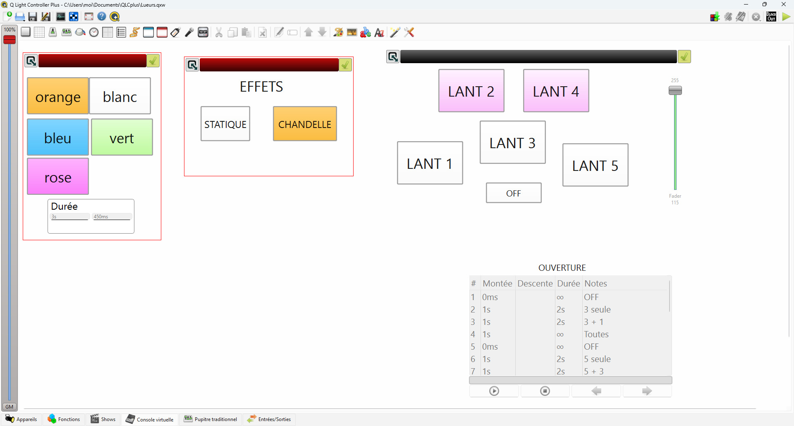

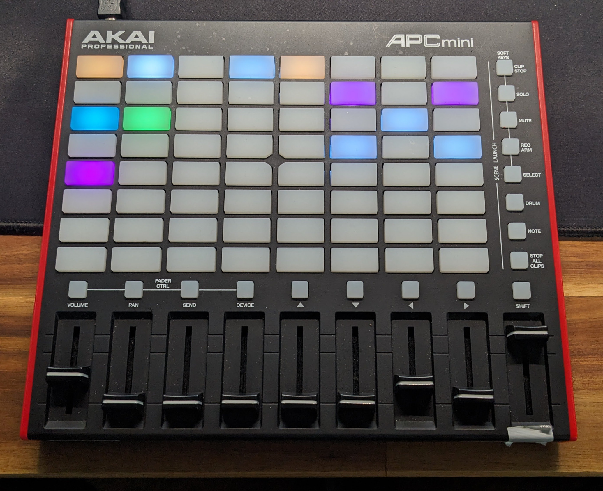

Bien sûr, le reste de l'installation lumière de la salle pourrait également être pilotée par le même logiciel, mais cela demanderait beaucoup de travail de programmation/recâblage à chaque représentation. L'idée est de conserver l'installation de la salle et ne pas complexifier le travail de régie, toujours dans l'idée de le rendre le plus accessible possible.

## Le rendu

Il est évident que je ne peux faire une liste exhaustive de toute la mise en scène du spectacle *Lueurs* qui emploie ces lanternes.

Je mets tout de même quelques visuels pour donner un peu de sens à tout ce travail.

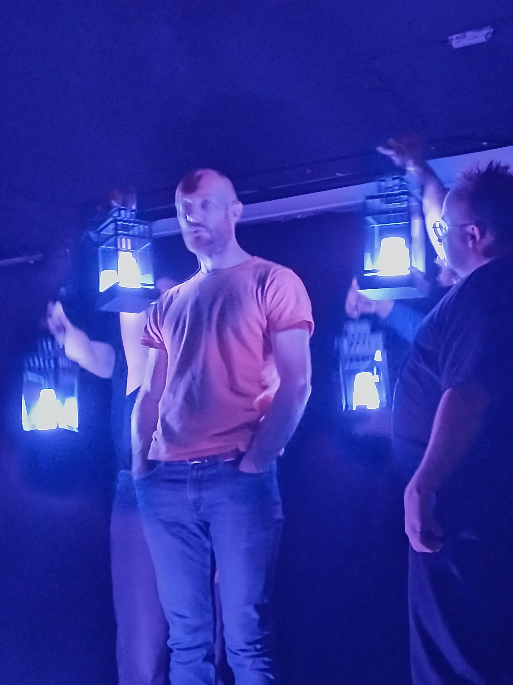

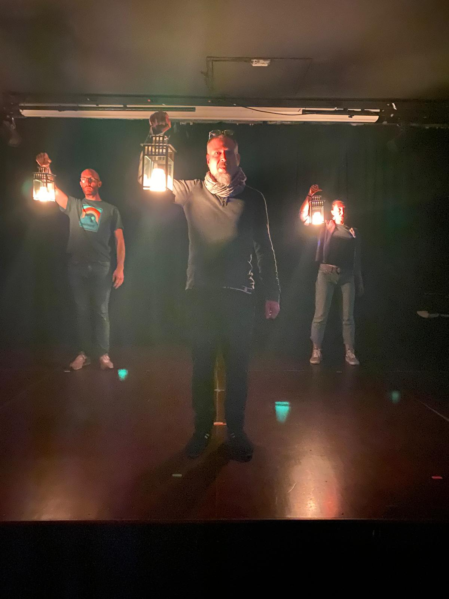

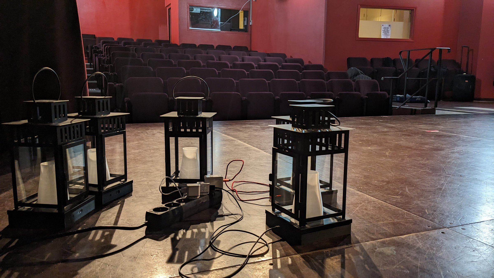


