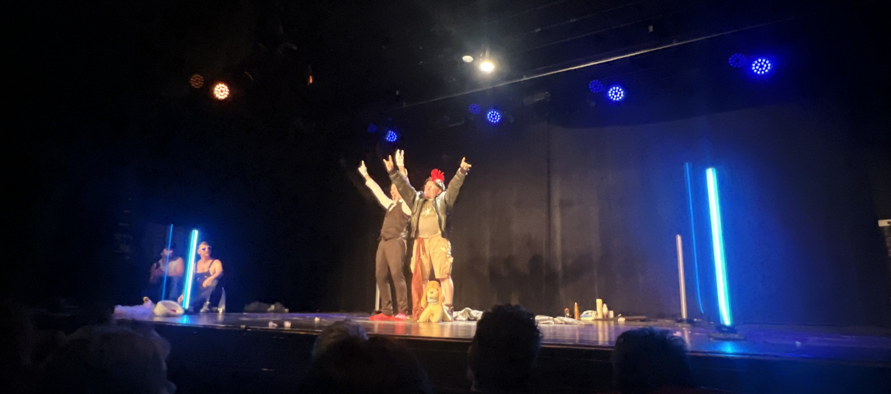

Every year, my improv troupe Les Acides Animés has one big date on the calendar: the Catch Impro, in a venue that seats around 270 people.

It's the show we put the most work into, aiming for something truly spectacular, with lots of guest performers.

The improv format is a "catch" — a wrestling-style match where pairs of characters "fight it out" inside a ring.

And more often than not, the ring is anything but grand. We use rather unsightly posts joined together with barrier tape. Not exactly a showstopper...

Then, somewhere in yet another aimless YouTube session, I stumbled upon a North American guy who had built his own light poles for his band:



What if the 2025 catch ring were made of light poles that could be controlled from the lighting desk...?

The idea was incredibly appealing, and the video suggested a build that wouldn't cost too much: perfect for our little troupe, which isn't exactly rolling in money.

My friends were on board, and the project kicked off with a hard deadline — the day of the show: March 29, 2025. In other words... **one month to do everything!**

## The requirements

I was itching to dive right in, but first I had to pin down what was actually needed, so I wouldn't get sidetracked:

- Diffused light, avoiding any visible "pixel" effect
- Four poles spaced out to form a square of at least 6 m x 6 m
- Poles at least 1 m tall
- A system that can be run from a traditional lighting desk (DMX)
- The option to use it without a desk, in standalone mode
- Sturdy parts that will last, with minimal maintenance
- A tight budget

## The design study

I already had some experience with projects using individually addressable WS2812 LED strips (notably my [Smartring project](https://www.youtube.com/watch?v=94tGvjmw-p8): a battery gauge and rear lights for an electric skateboard).

So those components were the natural choice — conveniently, they also come as self-adhesive strips.

My plan was to write the microcontroller code myself. Not impossible, but very time-consuming!

So I went back to digging around online for a similar project that would make this part easier.

And that's when I discovered the [WLED project](https://kno.wled.ge/)...

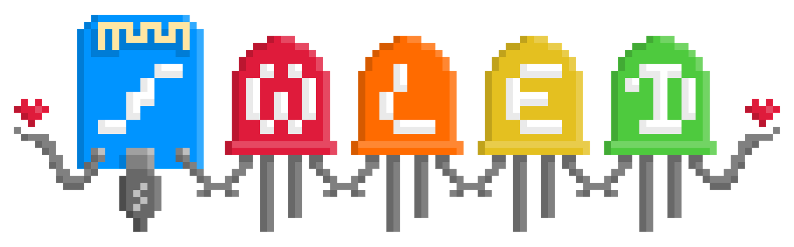

You just plug the ESP32 microcontroller into your computer, flash a generic firmware from a web page and, as if by magic, everything works in a snap.

DMX, Art-Net, a smartphone app, support for all kinds of LEDs... A dream come true!

Great — on to the electrical design.

### Overall concept

I borrowed the principle from the video mentioned at the start of this post and came up with the following diagram:

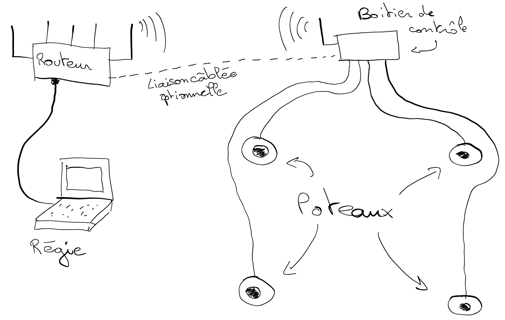

To match the ring size in my requirements, I went for 10 m of cable between the control box and each pole.

I didn't want to daisy-chain the poles, so as not to add extra points of failure to the system.

I also refined my component choices to meet the requirements:

- A DMX socket for control without Wi-Fi
- A microphone for sound-reactive control in standalone mode
- A 24 V power supply — the highest voltage available for LEDs — to keep the current down
- Fuses everywhere to protect the whole system and isolate any faulty part

I also wanted to add an Ethernet connection, to favour a wired link wherever possible, but there were too many unknowns and too much testing involved for the time I had.

### Electrical / electronics

Browsing the [WLED knowledge base](https://kno.wled.ge/advanced/longdata/), I quickly realised that the 10 m cable runs were going to be a potential problem.

Beyond 5 m, the raw data signal driving the LEDs can become too weak for them to respond properly...

I ran a test at home with some spare parts lying around and confirmed it.

So I'd have to use RS485 transmitters/receivers to keep the signal robust over long distances... That made my project a lot more complicated!

Still, I quickly landed on a first wiring diagram:

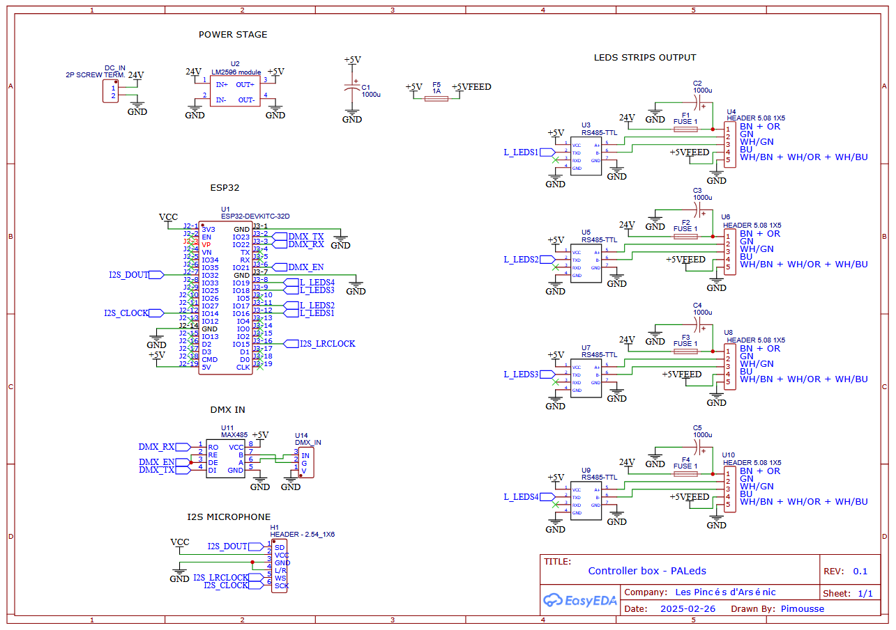

After plenty of testing on a breadboard, I was able to validate my design and send off for manufacturing both the control box PCB and the one that would go inside each pole.

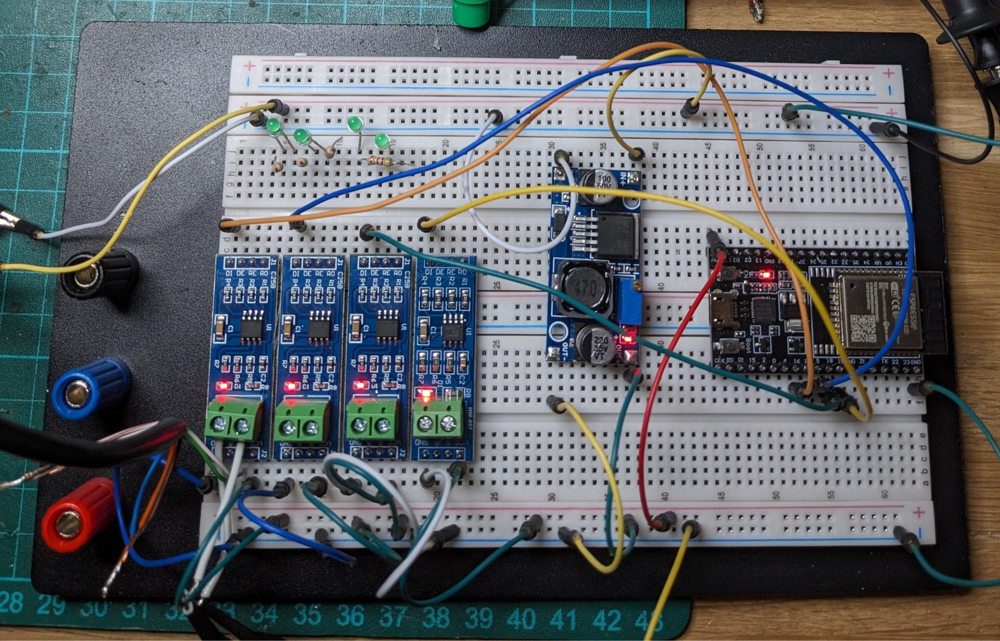

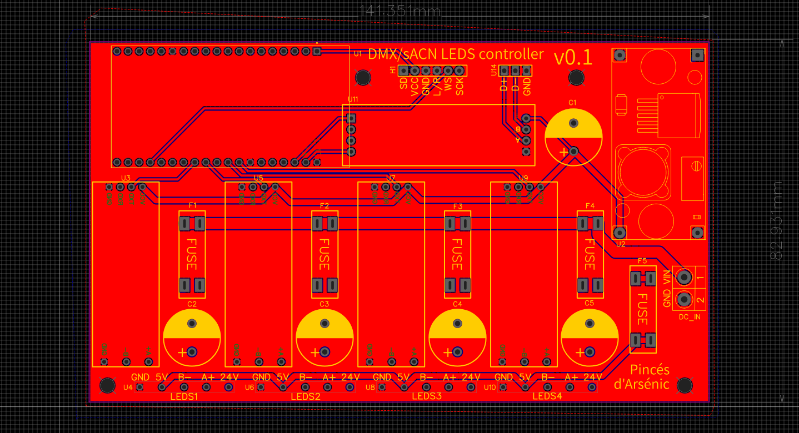

### Control box

For the enclosure, I wanted an off-the-shelf aluminium box rather than designing a 3D-printed one. I needed it to survive knocks (drops, bumps on stage, etc.) and last over time.

I found several sizes online.

The only way to be sure of picking the right one was to model all the components in CAD (computer-aided design) and find the ideal box.

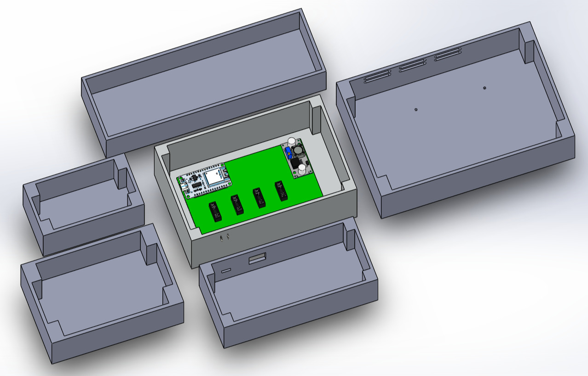

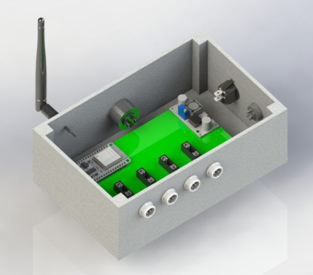

All that was left was to add every connector and accessory to make sure everything fit — and then place the order!

A second, simpler box would house the system's power supply.

I chose to keep the power supply separate because I plan to share it with other lights in the future.

### The light element



I'm a big fan of [BTF-lighting](https://www.btf-lighting.com/en-intl) products: they come in a wide range of pixel or COB strips, in various densities and supply voltages, at affordable prices.

I settled on a 24 V COB LED strip with 864 LEDs/m and 41.5 mm per addressable segment, sold in 5 m reels (around thirty euros for 4+1 poles).

Exactly what I needed!

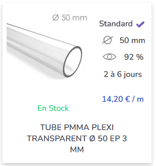

Now for the harder part to source: one-metre polycarbonate tubes.

Only the French website [Lacrylic](https://www.decoupe-plexi-sur-mesure.com/) offered what I was looking for... and it ate up a sizeable chunk of the budget.

## Assembly

### The poles



I had my first pole prototype **2 weeks** before the show... Time was running out!

To hide the LED strip, I sanded the tubes with fine-grit sandpaper to give them a "frosted" look.

For the base, I went the make-do route: empty 3D printer filament spools, plus a printed adapter to make up for the difference in diameter with the tube.

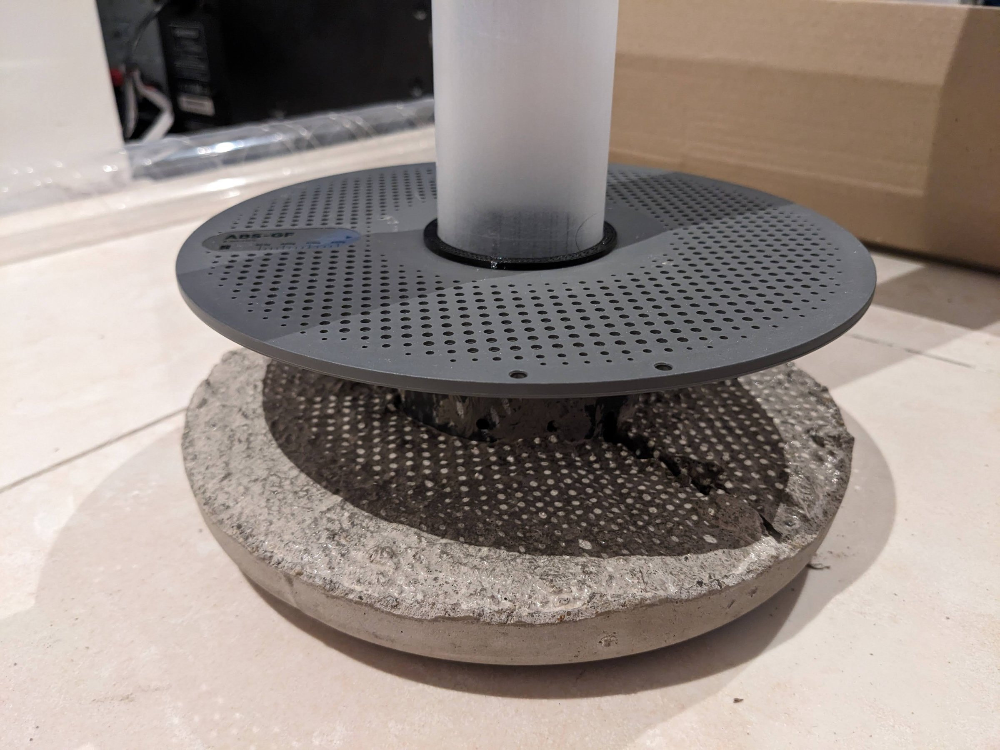

For extra stability, I poured concrete into the lower part of the spool.

That would do the job for March 29.

Next up: running the 10 m cables.

Using RS485 to send data to the poles meant my cable had to include a twisted pair. And I needed 40 m in total!

To save money, I went with RJ45 cable, using one pair for RS485 and the other three to share the power load (a pole at full white draws 1 A).

My first measurements still showed a 2.8 V voltage drop at 0.91 A — that's 3 ohms over 10 m... Not great, but it works.

### The electronics

The PCBs and all the components had arrived.

I fired up the soldering iron and put everything together as fast as I could.

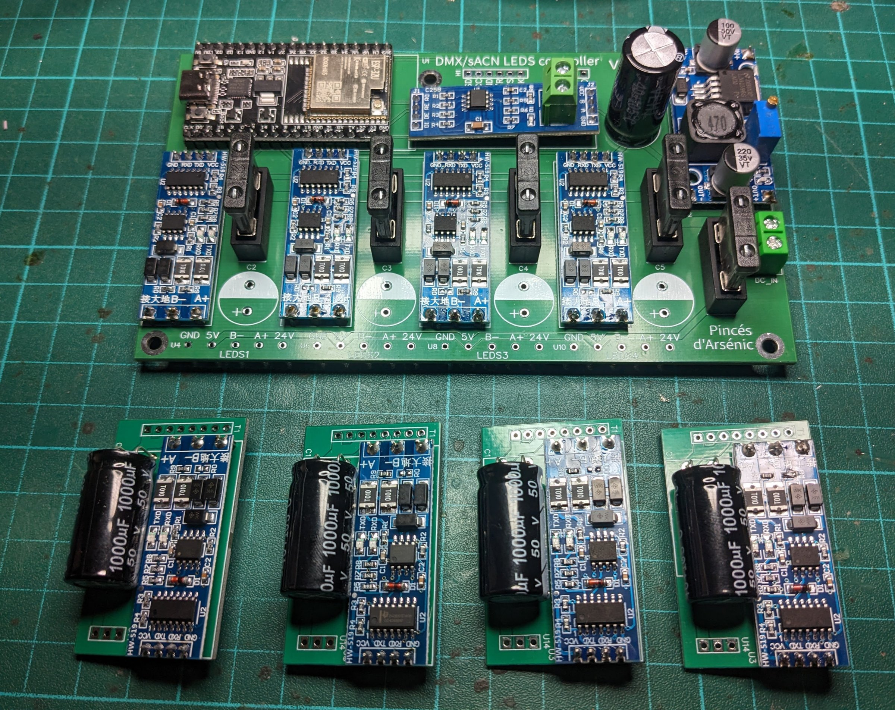

A few small design issues came up during testing (always double-check what you find online), but they were quickly fixed.

The pole boards fit perfectly inside the pole bases: challenge met.

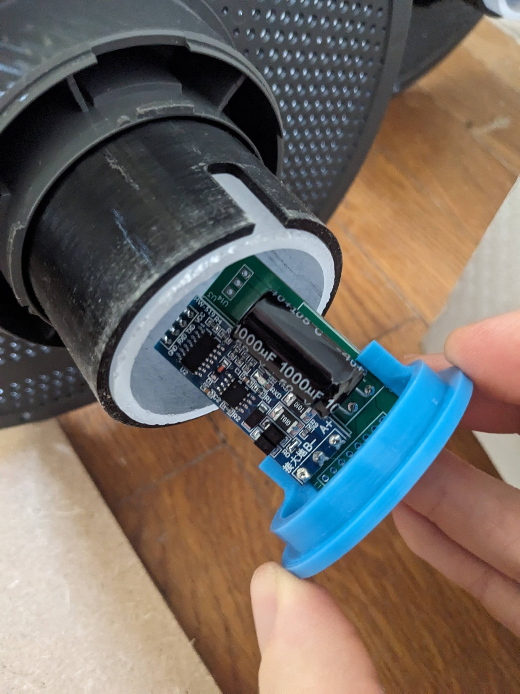

### The enclosures

Right, well. Die-cast aluminium boxes sound like a great idea, and they tick all my boxes.

But machining them without a proper workshop is a whole different story.

A step drill, a jigsaw, taps... whatever happened to be lying around.

In the end I didn't do too badly: my boxes were ready to take the electronics and connectors.

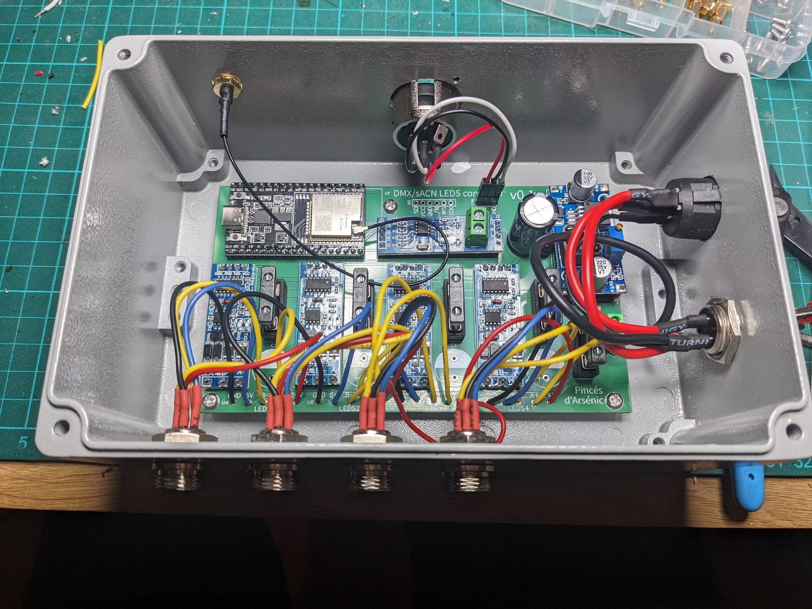

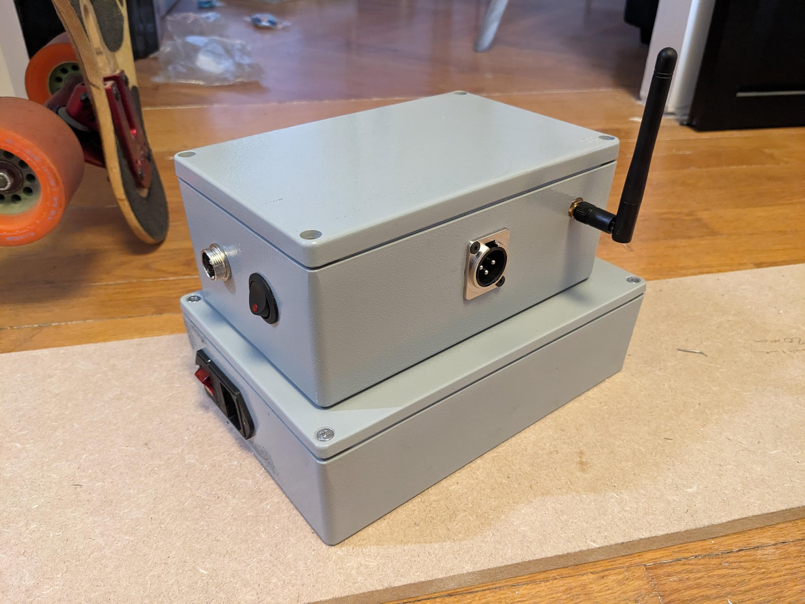

### Testing

Each part had been tested on its own, but everything still had to work together.

Then came the long-awaited moment: the first power-up!



Less than a week to go before the show.

After a few scares, fixed thanks to some spare parts (phew!), everything worked as hoped.

I rushed off to give the bases a coat of matte black paint and moved on to the final stage: programming.

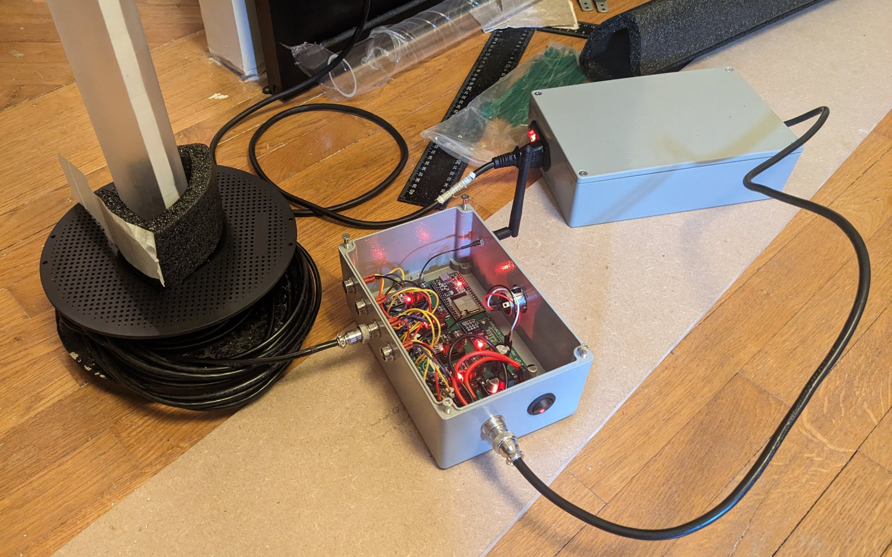

## Programming

One day before the show.

I got up early to tackle a full day of programming.

Luckily, WLED is extremely flexible.

Even though a single microcontroller drives all 4 poles, I can configure it to behave like 4 independent fixtures from a DMX point of view.

Speaking of which, I'm going to use software to control these poles, along with the rest of the venue's equipment, which includes conventional spotlights and RGB PAR cans.

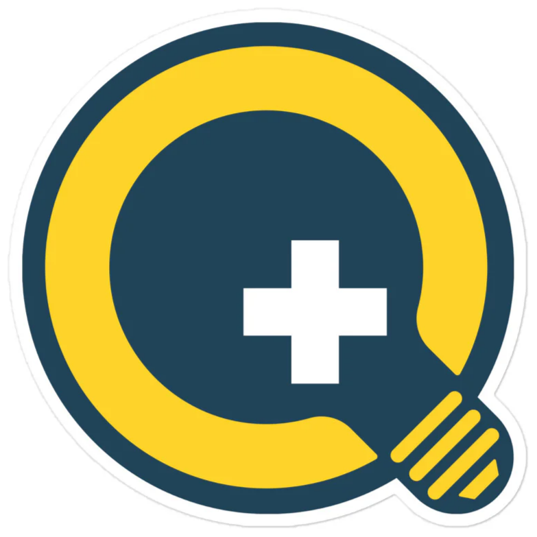

That software is [QLC Plus](https://www.qlcplus.org/)!

QLC Plus has become a go-to tool for hobbyists (and even for professionals, who sometimes use it for troubleshooting).

Developed as open source by an active community, it works with a wide range of USB controllers and DMX interfaces.

I've been using it for nearly 8 years now and have contributed to its development, notably by [sharing configuration files](https://www.youtube.com/watch?v=lrUuILNBtTM) for the Behringer X-Touch Compact — in my opinion the perfect companion for driving the software.

Recently, I added an AKAI APC Mini MK2 controller, whose freely configurable button colours make it the ideal sidekick for any show using RGB fixtures.

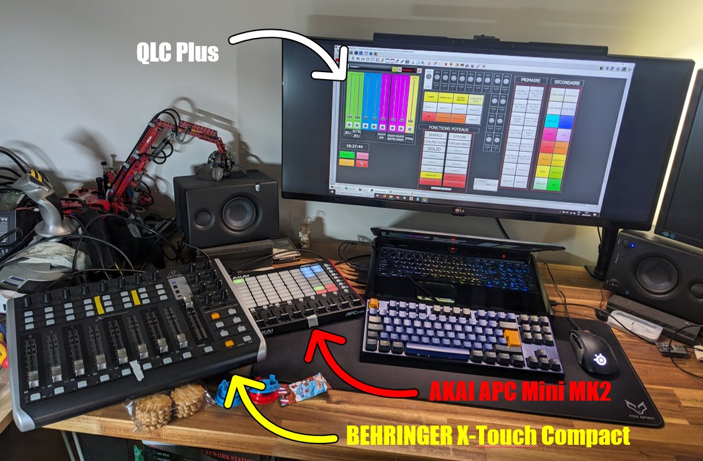

One of QLC Plus's big downsides, admittedly, is how time-consuming it is to get it to do exactly what you want.

One example: every button on the APC Mini has to be set up individually for its lighting behaviour, through a maze of menus and sub-menus.

And I have about fifty of them!

Quick tip: set up one button the way you want in QLC Plus, then open the file in a code editor such as [Notepad++](https://notepad-plus-plus.org/).

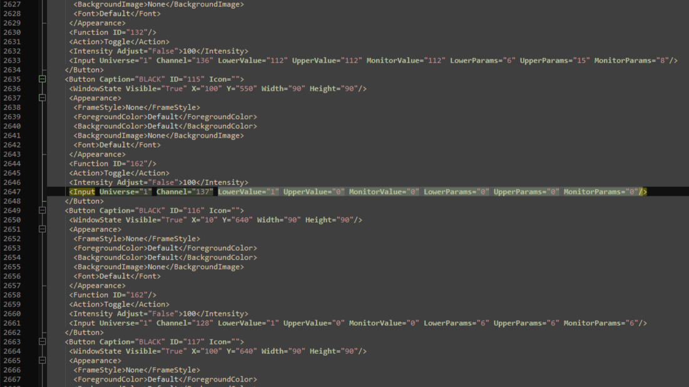

Copy the properties of the button you just configured and paste them onto every button that should behave the same way.

It saves a huge amount of time!

**Warning!!** Make sure to back up the file first, because it's easy to break its structure. If that happens, QLC Plus won't be able to read it anymore and a lot of functions will be lost.

## Going live

Here we are: March 29, 2025, 4 pm.

We walked through the venue doors; the show was due to start at 8:30 pm.

I handed the conventional lighting plot to the venue's technician and rushed off to set up, wire and power up the poles.

And then, trouble: pole no. 4 wouldn't light up.

The diagnosis was immediate: output no. 4 was no longer sending any data to the LEDs.

So I decided to disconnect no. 3 as well, keeping only the 2 downstage poles running.

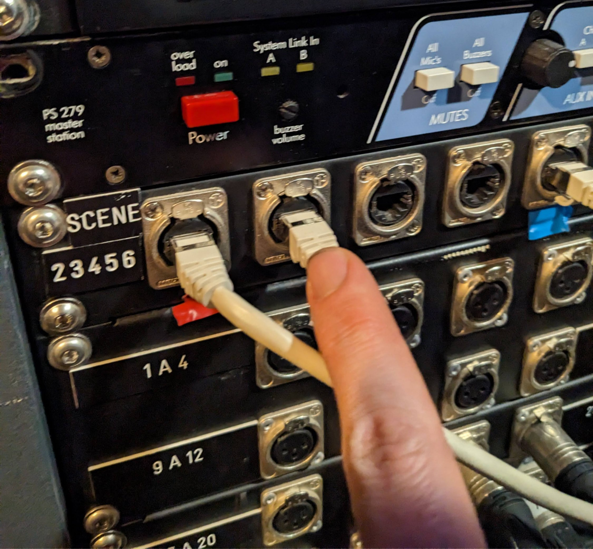

Then came network dropouts on the microcontroller: the poles would randomly stop responding for a few seconds.

The culprit: a router placed too far from the stage.

That's when the venue technician told me there were Ethernet sockets on stage that could be patched from the control booth.

Phew! We moved the router onto the stage, and the connection to the poles stayed rock-solid all evening (and I was glad I'd brought spare Ethernet cables).

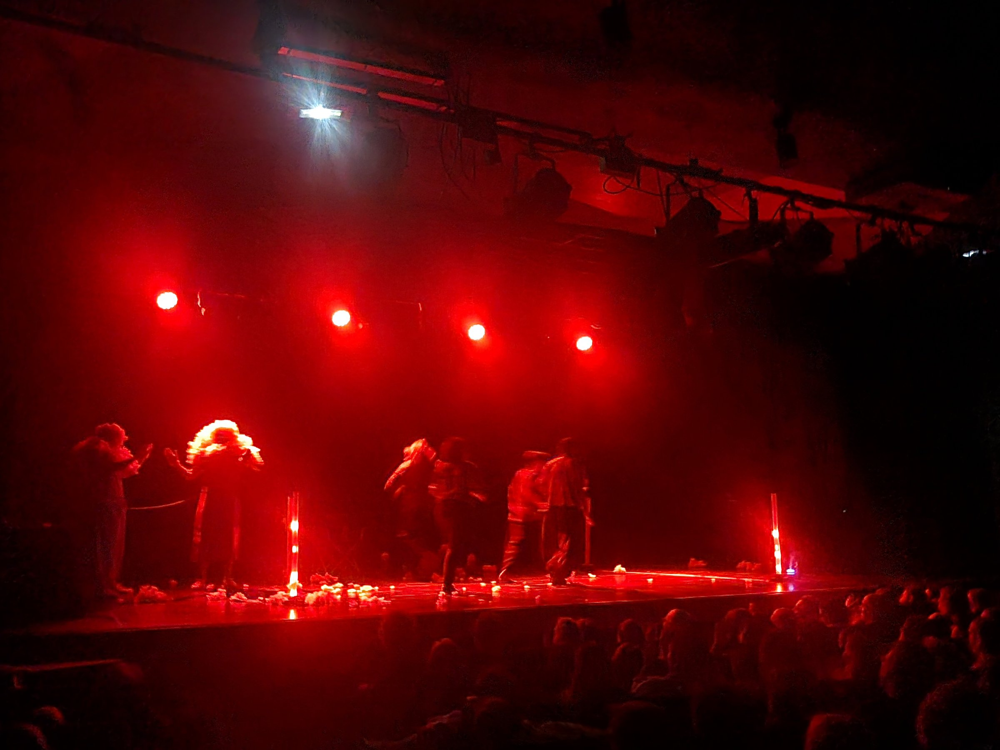

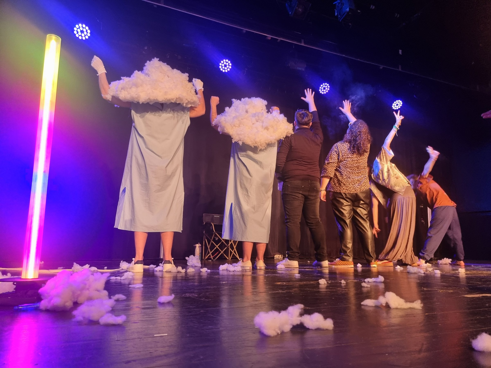

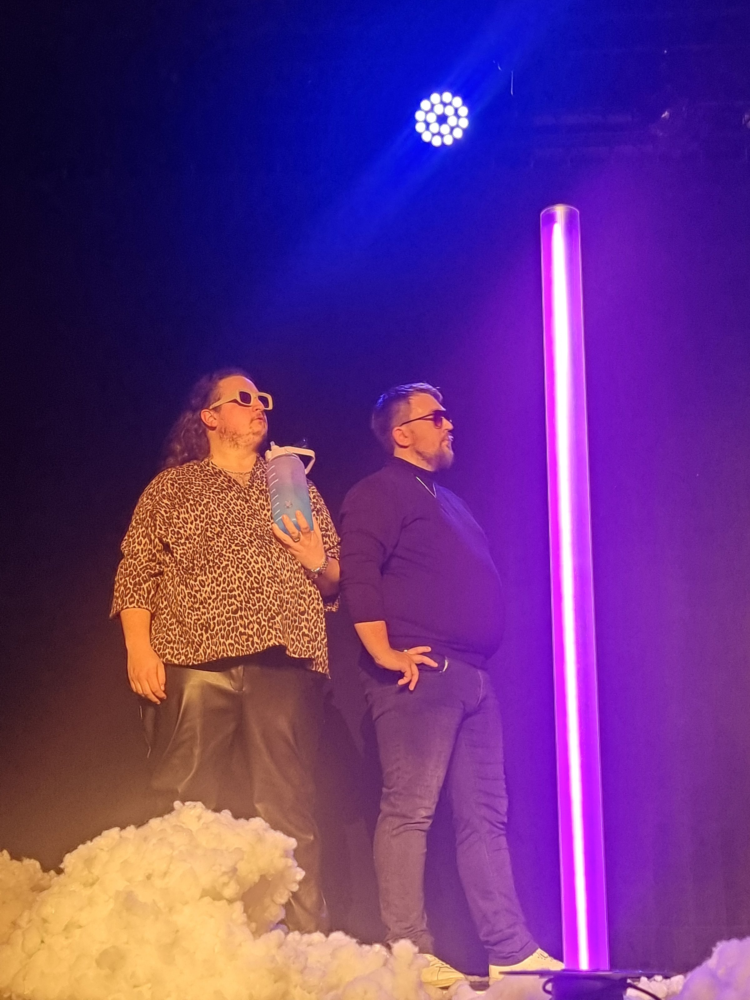

## Conclusion

This project was as stressful as it was educational.

Stressful because, obviously, having just one month for a project like this is a frantic race against the clock with very little room for failure.

Fortunately, experience helps a lot in that situation (always order a few spares, for instance).

It was also a very educational project, especially working with RS485 — a fairly old protocol by now, but one that still powers lots of communication systems, including... DMX!

Not everything went entirely to plan, since one of the 4 poles stopped working. The next day, I hooked the whole system back up in my workshop and others started failing too.

And on the night of the show, I was also booked for another gig with these poles at the end of May that same year.

And so the version 2 project was born!

To be continued in another post.
