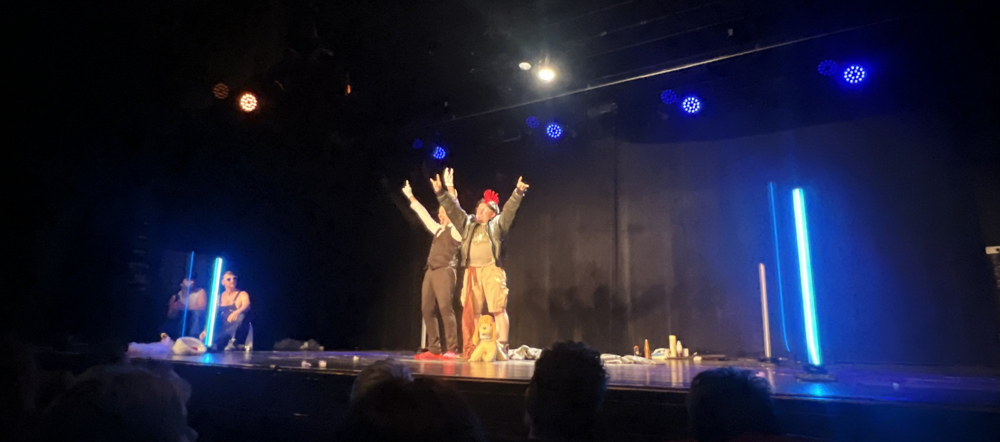

Tous les ans, dans la troupe des Acides Animés, il y a une date importante : le catch Impro dans une salle d'environ 270 personnes.

C'est une date pour laquelle on travaille beaucoup pour apporter un côté spectaculaire avec beaucoup de comédien·nes invité·e·s.

Le format d'improvisation théâtrale est un "catch" dans lequel des binômes de personnages "s'affrontent" dans un ring.

Et bien souvent, le ring n'a rien de grandiloquent. On utilise des poteaux peu esthétiques qu'on relie par de la rubalise. Le côté spectaculaire en prend un coup...

C'est alors qu'au détour d'une énième session d'errance sur Youtube, je tombe sur un nord-américain qui a fabriqué ses poteaux lui-même pour son groupe de musique :



Et si le ring du catch édition 2025 était composé de poteaux lumineux pilotables par la régie... ?

L'idée est extrêmement séduisante et la vidéo m'inspire du bricolage pas trop onéreux : parfait pour notre petite troupe qui ne roule pas sur l'or.

Mes ami·e·s valident mon idée, le projet démarre avec pour date butoir celle du spectacle : 29 mars 2025 soit... **un mois pour tout faire !**

## Le cahier des charges

J'ai hâte de me jeter dans le grand bain mais avant, il faut délimiter le besoin pour ne pas s'éparpiller :

- Une esthétique de la lumière diffusée en évitant un effet "pixels" visible
- Quatre poteaux espacés formant un carré de 6m x 6m au moins
- Les poteaux feront au moins 1m de hauteur
- Un système pouvant être opéré par une régie lumière traditionnelle (DMX)
- La possibilité de l'utiliser sans régie, en mode autonome
- Des éléments solides qui tiendront dans le temps, avec un minimum d'entretien
- Un budget serré

## L'étude

J'ai déjà un peu d'expérience sur des projets utilisant des bandes de leds adressables individuellement WS2812 (notamment mon [projet Smartring](https://www.youtube.com/watch?v=94tGvjmw-p8) : jauge de batterie et feux arrière pour skateboard électrique).

Mon choix part donc naturellement pour ces composants, d'ailleurs disponibles sous forme de bandes autocollantes.

Mon idée était de développer le code du micro-contrôleur. Pas impossible mais très chronophage !

Alors, je retourne fouiller internet pour trouver un projet similaire et me simplifier cette tâche.

Et là je découvre le [projet WLED](https://kno.wled.ge/)...

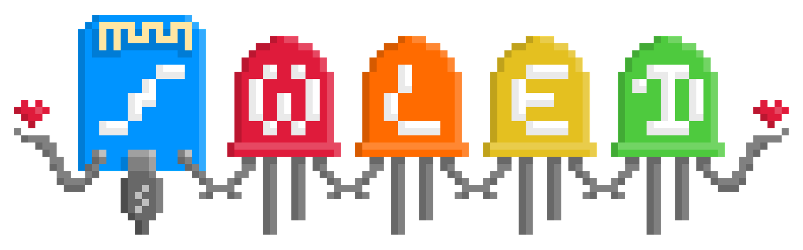

Il suffit de brancher le microcontrôleur ESP32 à l'ordinateur, charger un code générique par une page web et comme par magie, tout fonctionne d'un claquement de doigts.

DMX, Art-net, application smartphone, compatibles tous types de LEDS... Le rêve !

Parfait, je peux passer à l'étude électrique.

### Concept général

Je m'inspire du principe de la vidéo citée au début de cet article et arrive au schéma suivant :

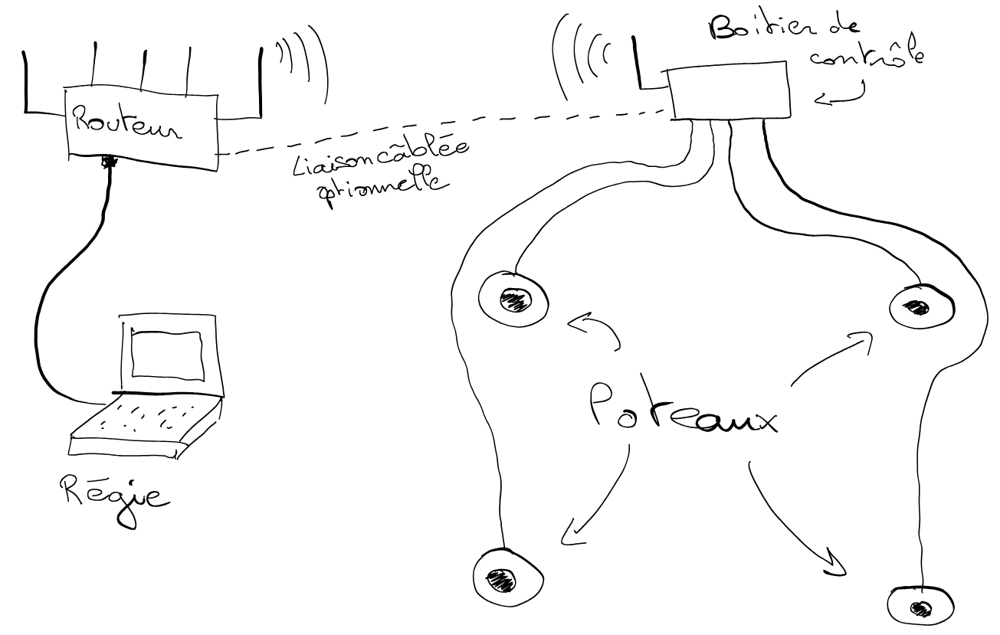

Pour respecter la taille du ring de mon cahier des charges, je pars sur 10m de câble entre le boitier et chaque poteau.

Je ne souhaite pas de mise en série (daisy chain) pour ne pas ajouter de point de défaillance dans mon système.

J'affine aussi le choix des composants pour respecter le cahier des charges :

- Prise DMX pour contrôle sans Wifi
- Micro pour contrôle par la musique, en mode autonome
- Alimentation 24V, la tension la plus élevée possible en LEDS pour réduire le courant
- Des fusibles partout pour protéger tout le système et isoler les éléments dysfonctionnant

Je voulais aussi ajouter une connexion Ethernet pour privilégier une liaison câblée autant que possible mais il y a trop d'incertitudes/essais à prévoir pour le temps imparti.

### Electrique / Electronique

En parcourant le [site de connaissances de WLED](https://kno.wled.ge/advanced/longdata/), je comprends rapidement que les 10m de câbles vont constituer un problème potentiel.

Au-delà de 5m, le signal brut d'information des LEDS peut devenir trop faible pour que celles-ci réagissent correctement...

Je fais le test chez moi avec du matériel qui traîne et je le confirme.

Je vais donc devoir passer par des émetteurs/récepteurs RS485 pour rendre le signal robuste sur de grandes longueurs... Voilà qui complexifie mon projet !

Je débouche néanmoins rapidement sur un premier schéma électrique :

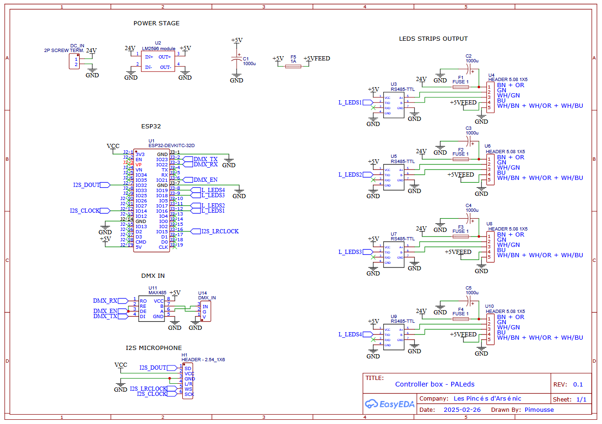

Après de nombreux tests sur une platine de prototypage (breadboard), je peux valider mon design et lancer en fabrication le circuit imprimé de la boîte de contrôle ainsi que celui qui sera intégré dans chaque poteau.

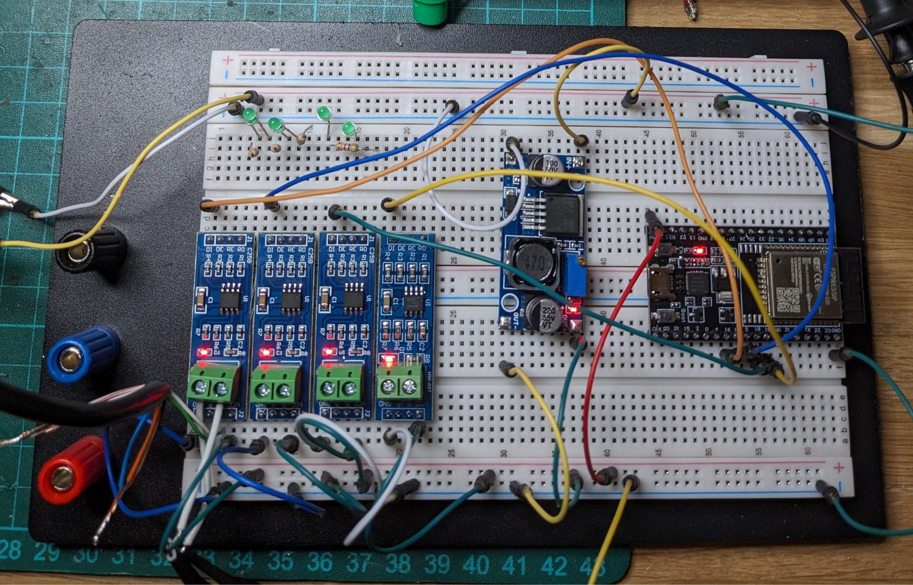

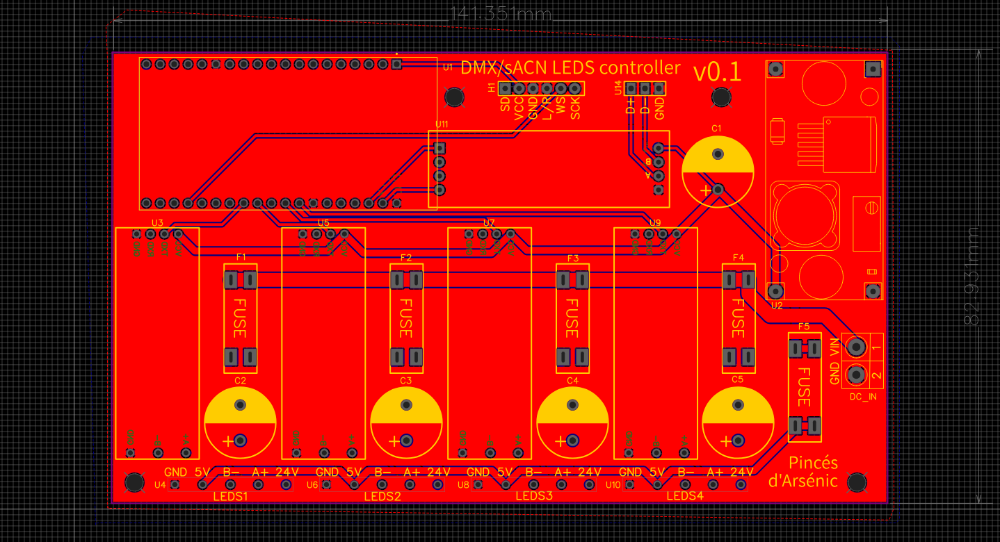

### Boitier de contrôle

Pour le boitier, je voudrais sélectionner un boitier aluminium du commerce plutôt que de concevoir un boitier imprimé en 3D. En effet, je veux que celui-ci puisse subir des chocs (chute, choc sur scène, etc.) et durer dans le temps.

Je trouve plusieurs formats sur internet.

Le seul moyen de s'assurer de choisir le bon est d'intégrer tous les composants en CAO (Conception Assistée par Ordinateur) et trouver la boite idéale.

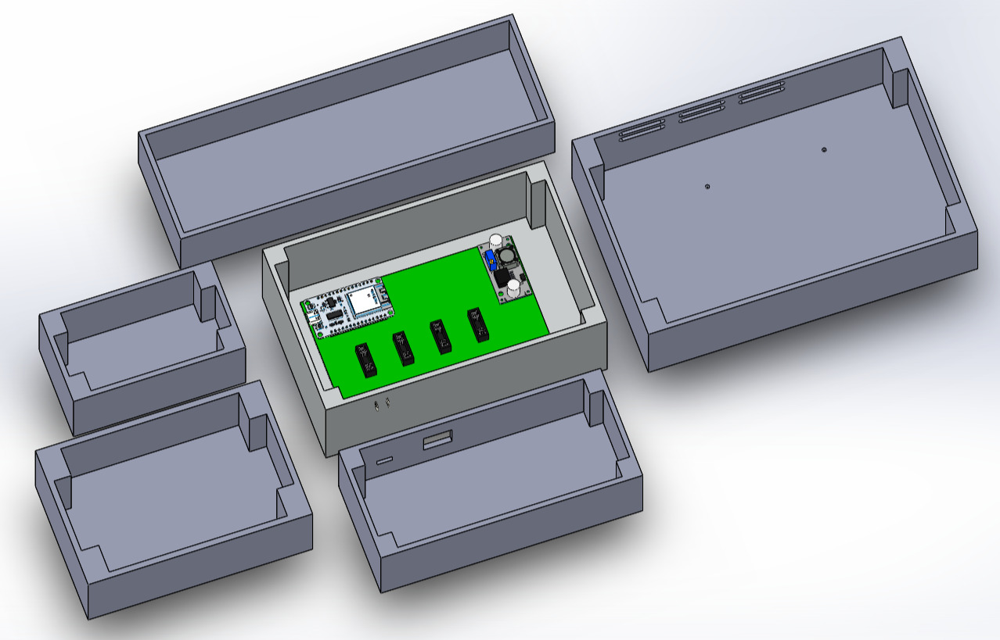

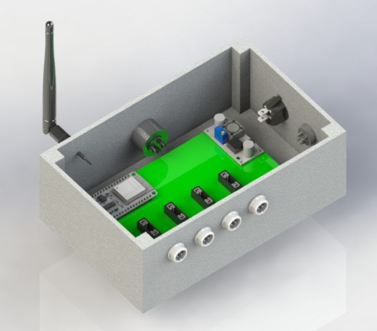

Il ne reste qu'à intégrer tous les connecteurs et accessoires pour s'assurer que tout rentre et on commande !

Un deuxième boîtier, plus simple, logera l'alimentation du système.

Je fais le choix de séparer l'alimentation car je prévois de pouvoir la partager avec de futures autres lumières.

### L'élément lumineux



J'aime beaucoup les produits [BTF-lighting](https://www.btf-lighting.com/en-intl), disponibles dans une large déclinaison en pixels ou COB, sous différentes densités ou tensions d'alimentation et à prix abordable.

Mon choix s'arrête sur une bande LEDS COB 864 LEDS/m, 24V, 41,5mm par tronçon pilotable, disponible en 5m (une trentaine d'euros pour 4+1 poteaux).

Exactement ce qu'il fallait !

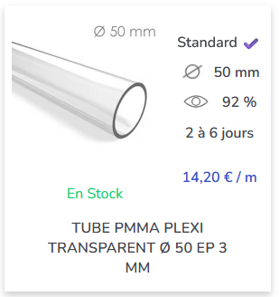

Maintenant voilà plus compliqué à sourcer : des tubes en polycarbonate d'un mètre.

Seul le site français [Lacrylic](https://www.decoupe-plexi-sur-mesure.com/) propose ce que je recherche... mais constitue une part non négligeable du budget.

## L'assemblage

### Les poteaux



J'ai mon premier prototype de poteau **2 semaines** avant le spectacle... Il reste très peu de temps !

Pour masquer la bande de led, je ponce les tubes au grain fin pour donner un aspect "givré".

Pour le socle, je vais faire système D : des bobines vides de filament pour imprimante 3D et un adaptateur imprimé pour compenser la différence de diamètre avec le tube.

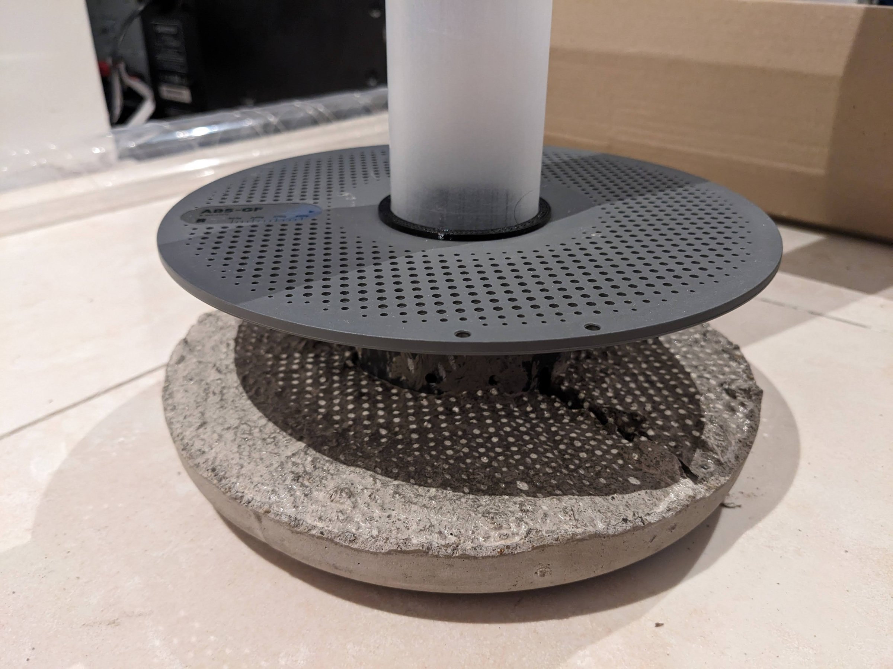

Pour donner plus de stabilité, je coule du béton sur la partie inférieure de la bobine.

Voilà qui fera l'affaire pour le 29 mars.

Il reste à installer les 10m de câble.

L'emploi du RS485 pour transmettre les données aux poteaux m'impose néanmoins la présence d'une paire torsadée dans mon câble. Et il m'en faut 40m au total !

Je fais le choix économique d'utiliser du câble RJ45 en utilisant une paire pour le RS485 et les 3 autres pour partager la puissance (un poteau allumé à fond en blanc consomme 1A).

Mes premières mesures montrent tout de même un affaissement de la tension de 2,8V sous 0,91A soient 3 ohms pour 10m... C'est pas génial, mais ça fonctionne.

### L'électronique

Les circuits imprimés et tous les composants sont arrivés.

J'allume le fer à souder et assemble tout cela au plus vite.

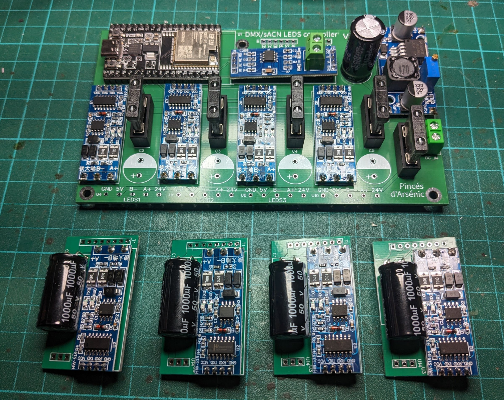

Il y a des petits soucis de conception lors des tests (toujours vérifier ce que l'on trouve sur internet), mais c'est vite corrigé.

Les cartes des poteaux entrent parfaitement dans la base du poteau : défi réussi.

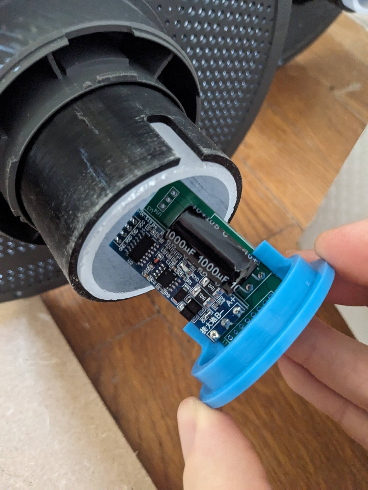

### Les boitiers

Alors, bon. L'idée de boitiers en aluminium moulé, ça semble bien et ça respecte mon cahier des charges.

Mais pour l'usinage, sans atelier de mécanique, c'est une autre paire de manches.

Forêt étagé, scie sauteuse, tarauds... voilà ce qui traine ici et là.

Finalement je m'en sors pas trop mal, mes boitiers sont prêts pour accueillir électronique et connecteurs.

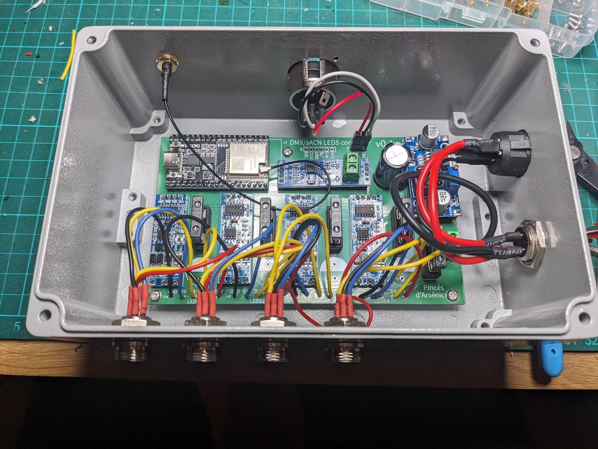

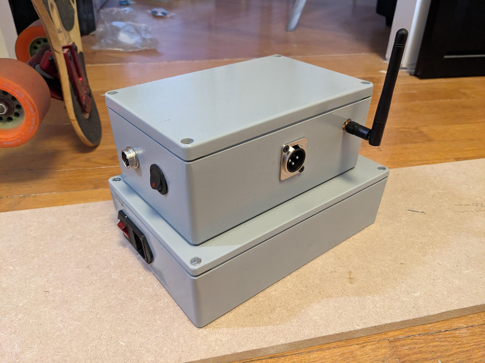

### Tests

Chaque élément a été testé séparément, mais il faut encore faire fonctionner le tout ensemble.

Viens le moment tant attendu : le premier allumage !



Il reste moins d'une semaine avant le spectacle.

Après quelques petites frayeurs réparées par des éléments en rabe (ouf !), tout fonctionne comme espéré.

Je file donner un coup de peinture noire mat sur les pieds et passe à l'étape finale : la programmation.

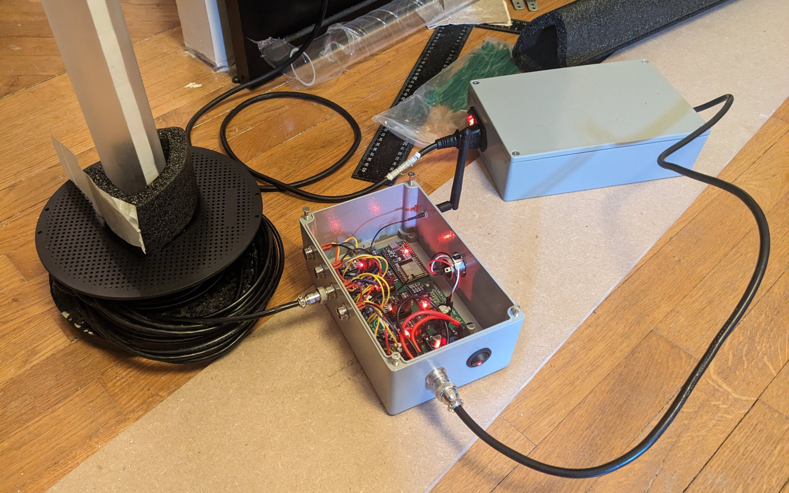

## La programmation

J-1 avant le spectacle.

Je me lève de bonne heure pour attaquer une journée complète de programmation.

Heureusement, WLED est extrêmement flexible.

Bien qu'un seul micro-contrôleur pilote les 4 poteaux, je peux le programmer afin qu'il se comporte comme 4 appareils indépendants du point de vue DMX.

A ce propos, je vais utiliser un logiciel pour piloter ces poteaux, de même que le reste du matériel de la salle de spectacle qui comprend des projecteurs traditionnels et PAR RGB.

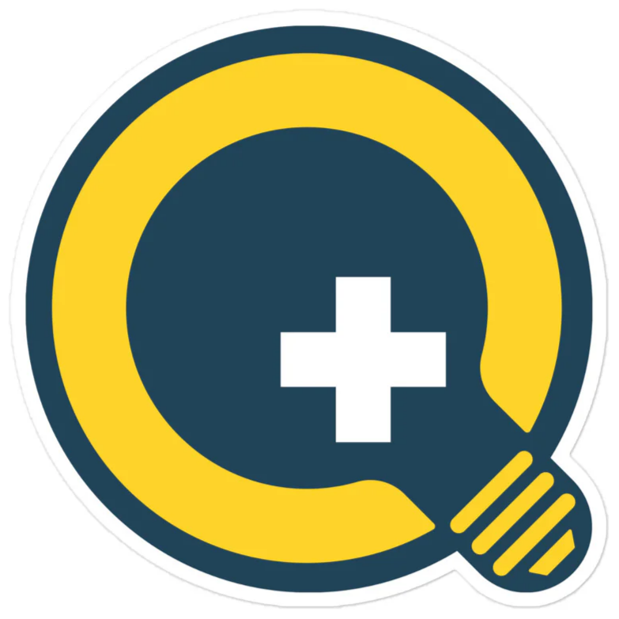

Ce logiciel, c'est [QLC Plus](https://www.qlcplus.org/) !

QLC Plus est devenu une référence auprès des amateurs (comme des professionnels qui l'utilisent parfois à des fins de diagnostic).

Développé en open source par une communauté active, il offre une grande compatibilité avec les contrôleurs USB et interfaces DMX.

Je l'utilise depuis maintenant près de 8 ans et ai participé à son développement notamment en [partageant des fichiers](https://www.youtube.com/watch?v=lrUuILNBtTM) de configuration pour Behringer X-Touch Compact, le compagnon idéal selon moi pour piloter le logiciel.

Depuis peu, j'y ai joint un contrôleur AKAI APC Mini MK2 dont la liberté de paramétrage des couleurs de touche en fait l'allié idéal pour tous les spectacles utilisant des appareils RGB.

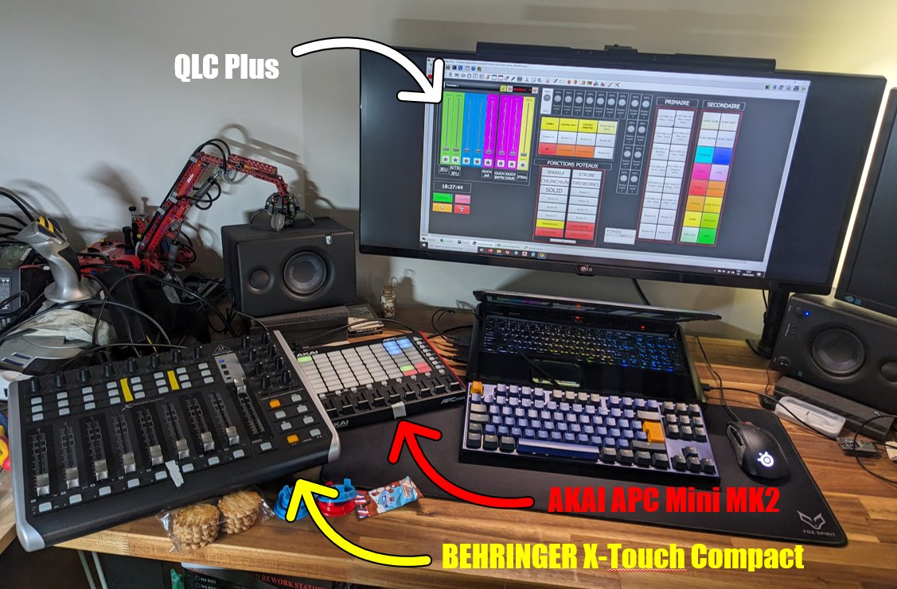

Un des gros points négatifs de QLC Plus, il faut l'admettre, est l'aspect chronophage pour arriver à ce qu'on désire programmer.

Un exemple : chaque bouton de l'APC Mini doit être programmé individuellement pour son comportement lumineux, dans un enchainement de menus et sous-menus.

Et j'en ai une cinquantaine !

Petite astuce : programmer un bouton comme désiré sur QLC Plus puis ouvrir le fichier avec un éditeur de code tel que [Notepad++](https://notepad-plus-plus.org/).

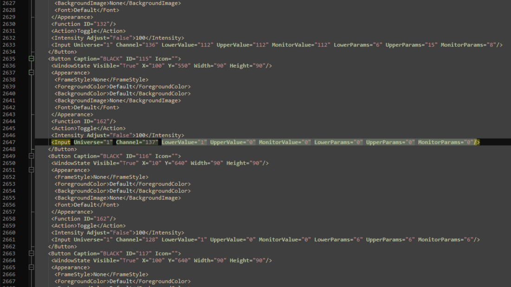

Copier les propriétés du bouton précédemment paramétré et coller ces propriétés à tous les boutons dont on souhaite le même comportement.

Le gain de temps est colossal !

**Attention !!** Bien faire une sauvegarde du fichier au préalable car il est facile de casser la structure du fichier. Dès lors, QLC Plus ne saura plus l'interpréter et bon nombre de fonctions seront perdues.

## La mise en production

Nous y sommes, le 29 mars 2025, 16h.

Nous passons les portes de la salle, début du spectacle prévu à 20h30.

Je remets le plan de feux des trads au régisseur de la salle et file installer, câbler et allumer les poteaux.

Et là, problème : le poteau n°4 ne s'allume pas.

Le diagnostic est immédiat : la sortie n°4 ne sort plus aucune données aux LEDS.

Je décide donc de déconnecter le n°3 pour ne laisser opérationnels que les 2 poteaux en avant scène.

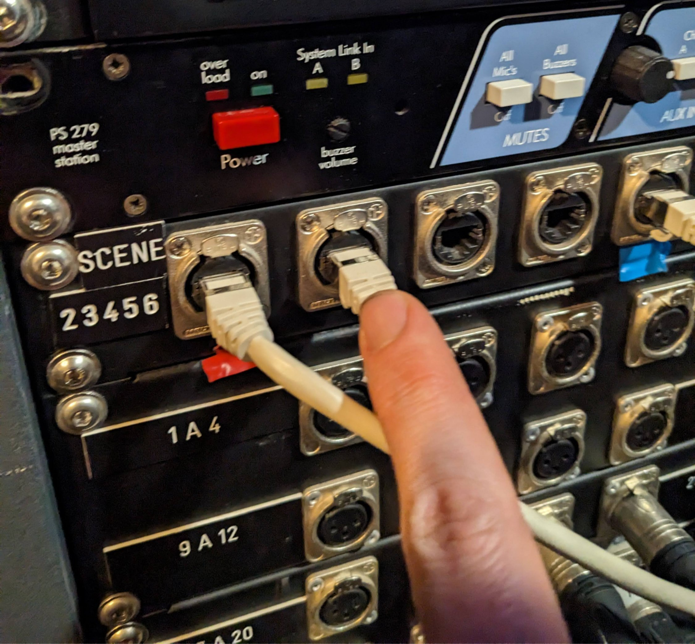

Puis viennent des problèmes de déconnexion du micro-contrôleur du réseau : les poteaux ne répondent plus pendant quelques secondes de manière aléatoire.

La faute à un routeur trop loin de la scène.

C'est là que le régisseur m'informe que la salle dispose de prise Ethernet sur scène que l'on peut patcher depuis la régie.

Ouf ! Le routeur est alors déplacé sur scène, la connexion avec les poteaux restera stable toute la soirée (et j'étais heureux d'avoir pris des câbles Ethernet en rabe).

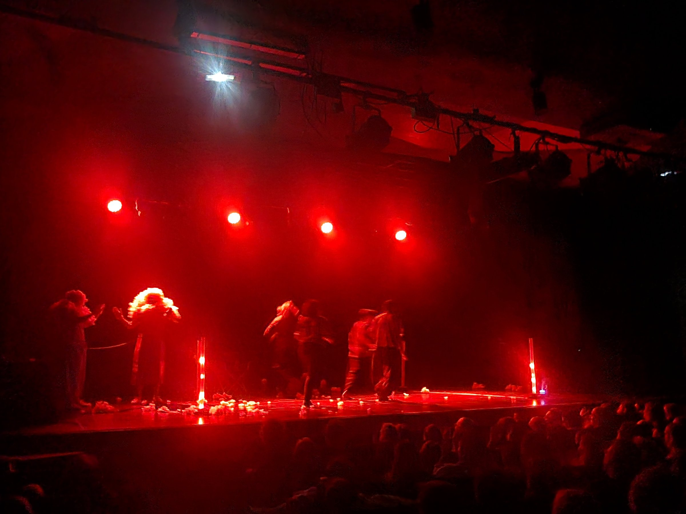

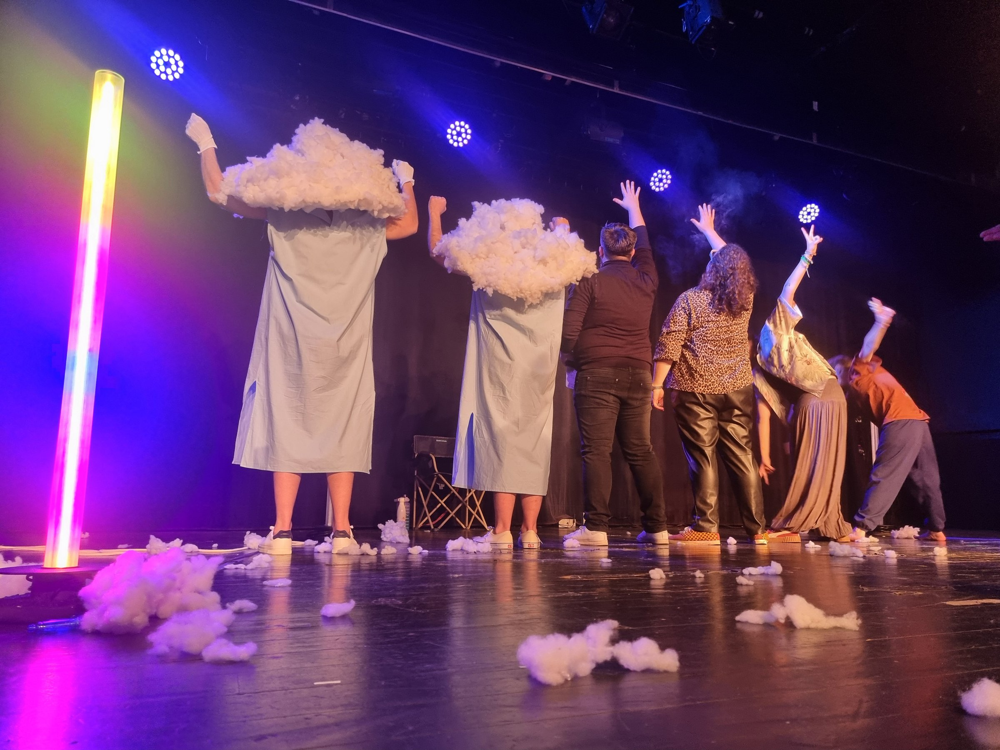

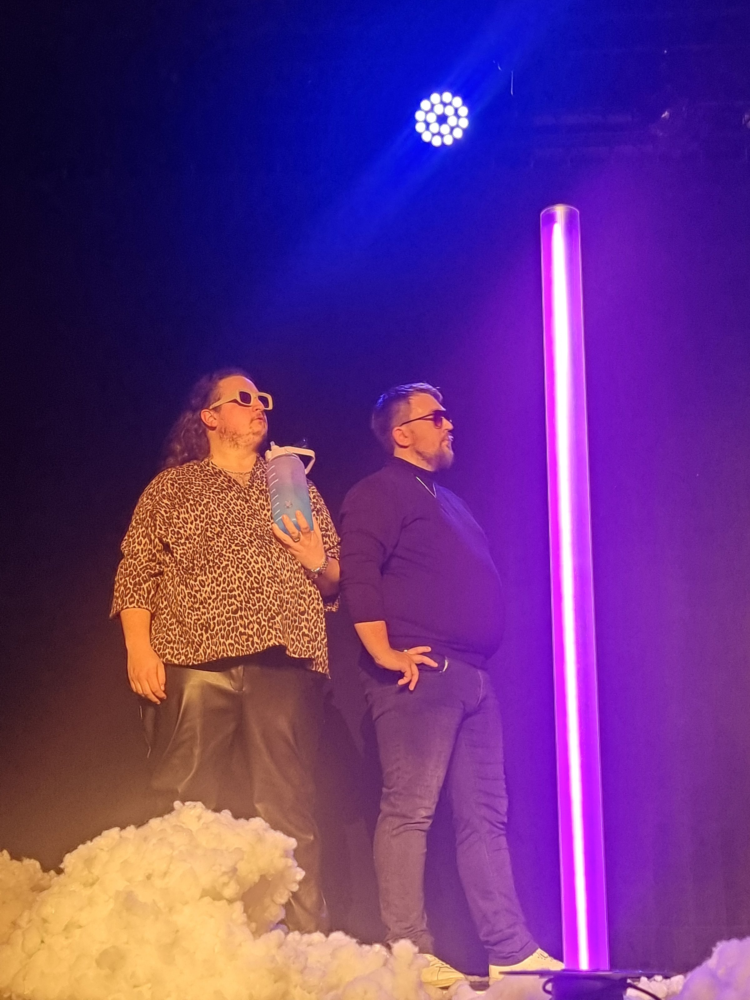

## Conclusion

Ce projet a été aussi stressant que formateur.

Stressant, car évidemment, ne disposer que d'un mois pour un tel projet, c'est une course contre la montre effrénée avec peu de place à l'échec autorisé.

Heureusement, l'expérience dans ce cas aide beaucoup (comme par exemple commander toujours un peu de rabe).

C'est aussi un projet très formateur notamment autour du travail avec le RS485, un protocole assez ancien maintenant mais qui continue à faire fonctionner encore beaucoup de communications comme... le DMX !

Tout ne s'est pas totalement terminé comme prévu puisqu'un des 4 poteaux à cesser de fonctionner. Le lendemain, j'ai rebranché tout le système dans mon atelier et d'autres se sont mis à cesser de fonctionner également.

Et puis le soir du spectacle, on m'a également commandé une prestation avec ces poteaux pour fin mai de la même année.

Voilà qui lance le projet de la version 2 !

A suivre dans un autre article.
