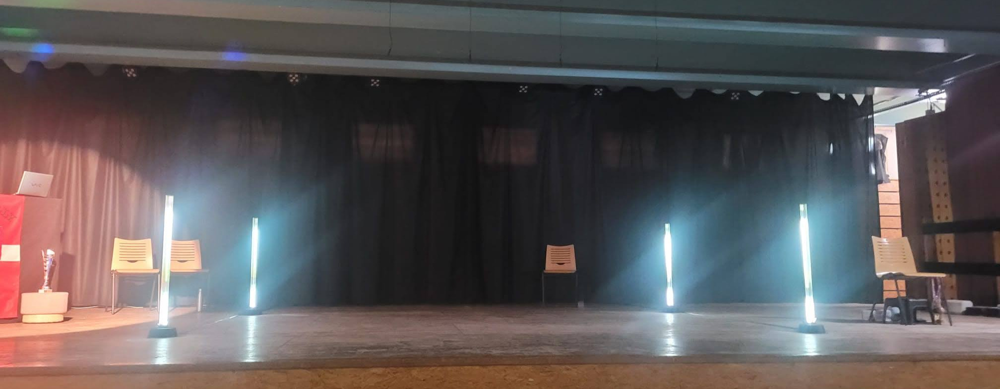

Si vous n'avez pas lu la genèse de ce projet avec la version 1, je vous invite à lire cet article en premier : [Poteaux lumineux - version 1]().

## Pourquoi ?

A la fin du précédent article, je parlais d'un mal étrange qui "cramait" les sorties des poteaux les unes après les autres.

Ensuite, le transport des poteaux solidaires de leur base jusque la salle s'est trouvé assez compliqué et le béton des socles s'effritait faisant apparaitre le gris du béton.

Voilà donc 3 sujets qu'il va falloir retravailler :

- Les socles
- La transportabilité
- La robustesse du système électrique et électronique

On est alors le 1er avril (si si !) et tout doit être prêt pour le matin du 28 mai.

Ca laisse bien plus de temps que pour la première version.

## L'électronique

C'est étrange que jusqu'ici je n'ai pas eu de problème et soudainement tout casse...

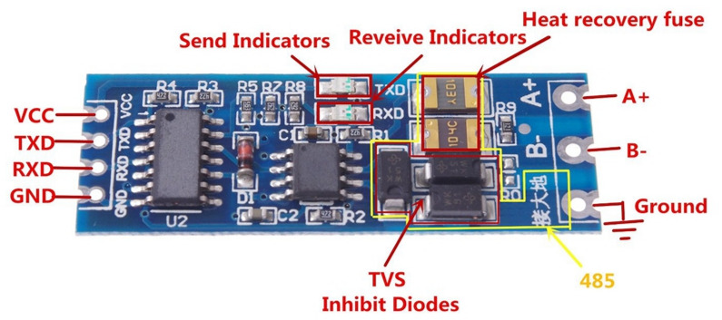

Je suspecte d'abord un problème avec les émetteurs/récepteurs RS485 dont la version que j'ai choisi comporte bon nombre de composants de protection.

Hélas, je ne me fournis que sur des sites chinois bon marché, il y a donc toujours un risque de mauvaise conception et/ou fabrication.

J'opte alors pour un autre modèle.

A réception, je remplace ces composants et les premiers tests... n'arrangent rien.

Ces cartes continuent de ne plus fonctionner !

Ok. Il va falloir sortir l'oscilloscope et analyser cela méticuleusement car le mystère s'épaissit.

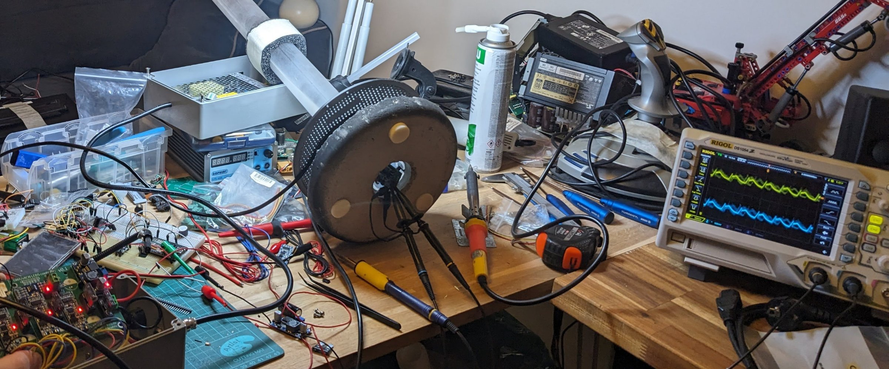

Les signaux sont affreux, je ne comprends pas. Les émetteurs RS485 sont dans un état second.

Je les remplace par des neufs. Je les analyse avant de tout remonter : signaux parfaits.

Je reconnecte le poteau : la carte redevient tel un zombie transformé pendant la nuit.

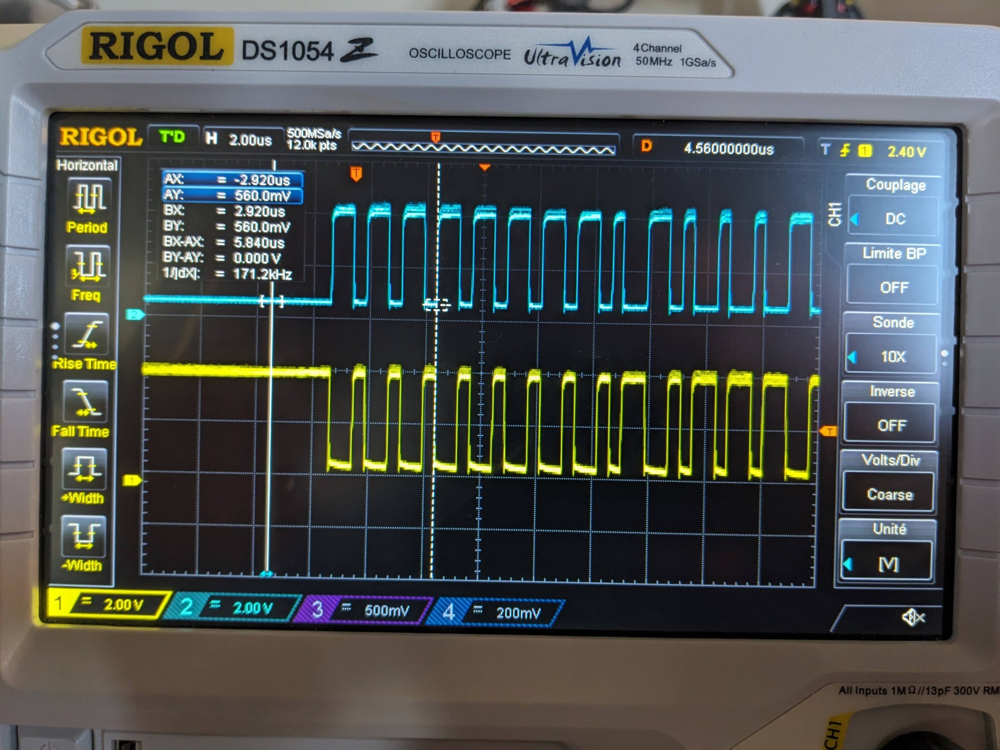

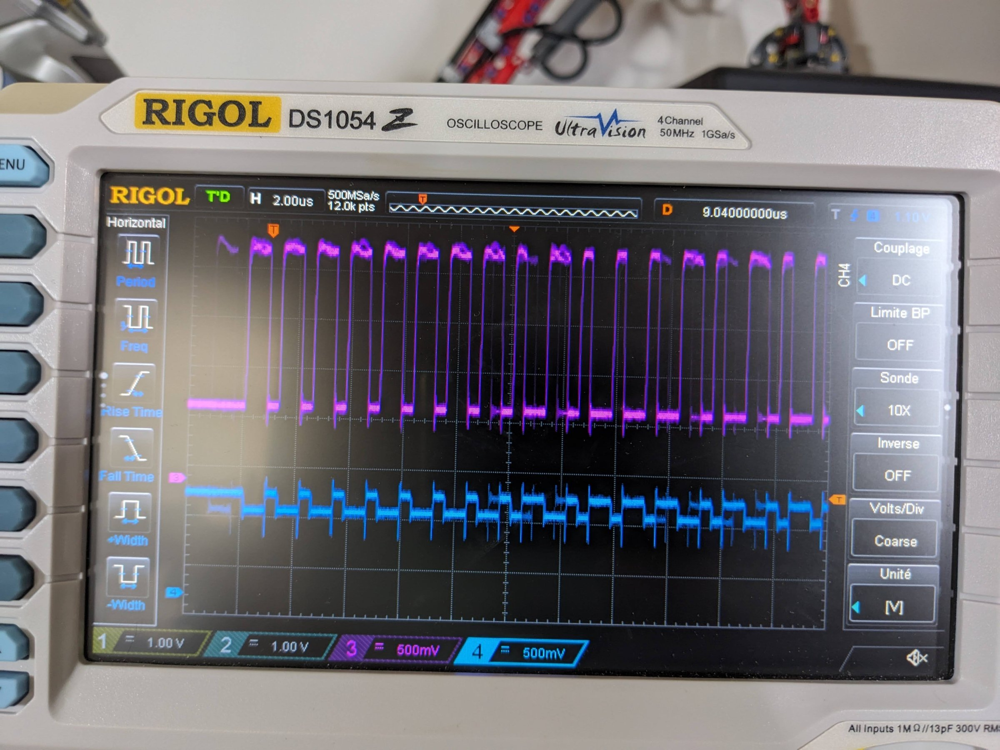

Encore pire, la forme du signal au niveau du récepteur dans la base du poteau. Celui-ci souffre de déformations telles que le signal lui est à peine compréhensible.

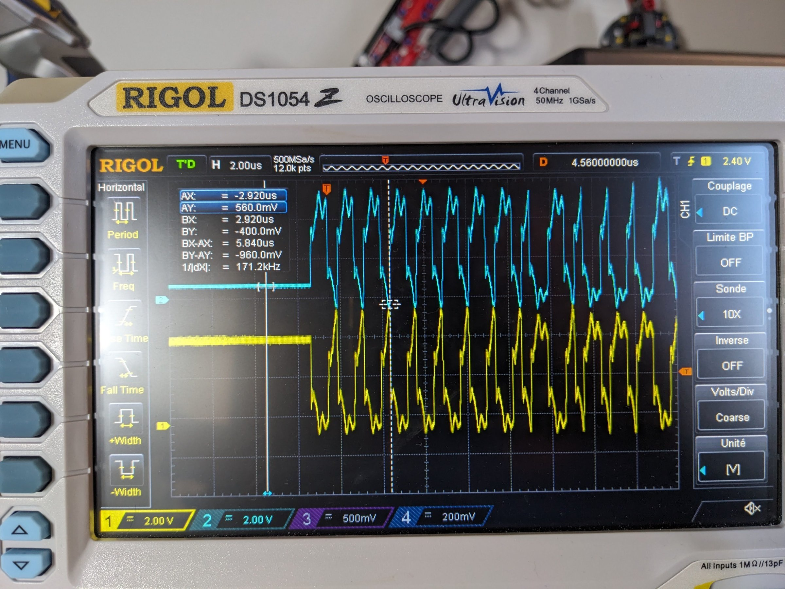

Voilà maintenant 1 mois que je m'arrache les cheveux sur ce problème.

J'ai maintenant tout changé, j'ai conçu une nouvelle carte électronique, ré-arrangé les récepteurs et... rien.

A moins que... Non ! Il reste une chose que je n'ai pas changé.

Vous souvenez-vous, dans [l'article de la version 1](), du câble que j'avais acheté pour connecter les poteaux ?

Oui, ces 50m de RJ45 très bas de gamme qui n'avaient d'intéressant que leur prix.

Je teste avec un autre câble qui traîne chez moi : le signal au poteau retrouve des couleurs et surtout ne subit plus de déformations.

Et si c'était ça le problème depuis le début ? Le câble de mauvaise facture.

Difficile à croire mais pour en avoir le cœur net, je décide de commander des [câbles EtherCon de 10m](https://www.thomann.fr/pro_snake_cat6e_cable_10m.htm) dédiés pour le spectacle ainsi que les connecteurs qui vont avec.

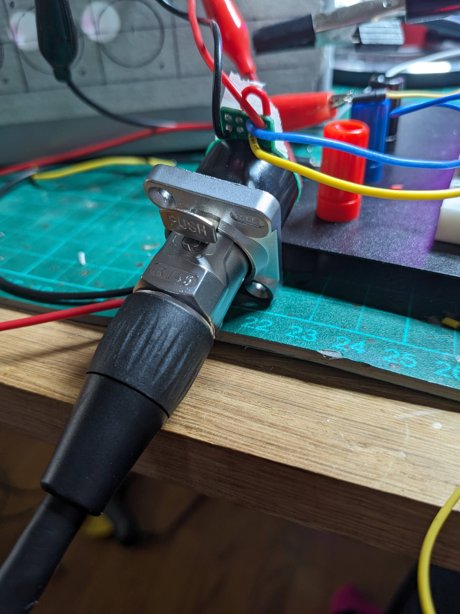

Le connecteur est raccordé à la nouvelle carte, le câble est branché, il ne reste plus qu'à allumer le système.

Il reste un mois pour tout terminer, alors il FAUT que ça fonctionne...

Et là, c'est un soulagement !

Tous les problèmes venaient bien de la qualité déplorable du câble RJ45 bas de gamme.

Je sais que la qualité des câbles peut varier de bien des façons, mais au point de griller des composants, je ne m'en serais jamais douté.

Ce qu'affiche l'oscilloscope est alors un véritable soulagement.

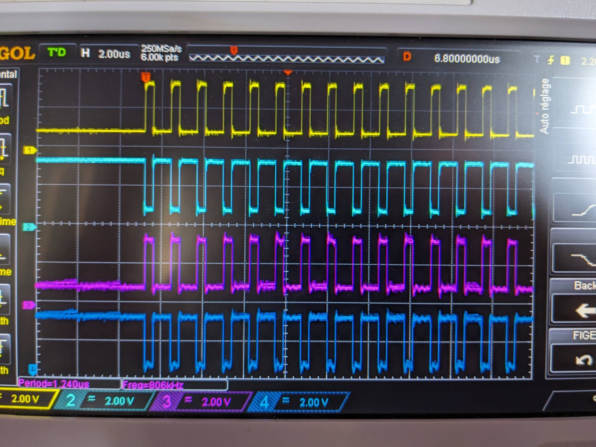



Je m'empresse de modifier le boitier (non sans mal) pour y intégrer les connecteurs EtherCon.

Je suis absolument satisfait de ces connecteurs, beaucoup plus robustes que ceux employés sur la version 1 (GX16).

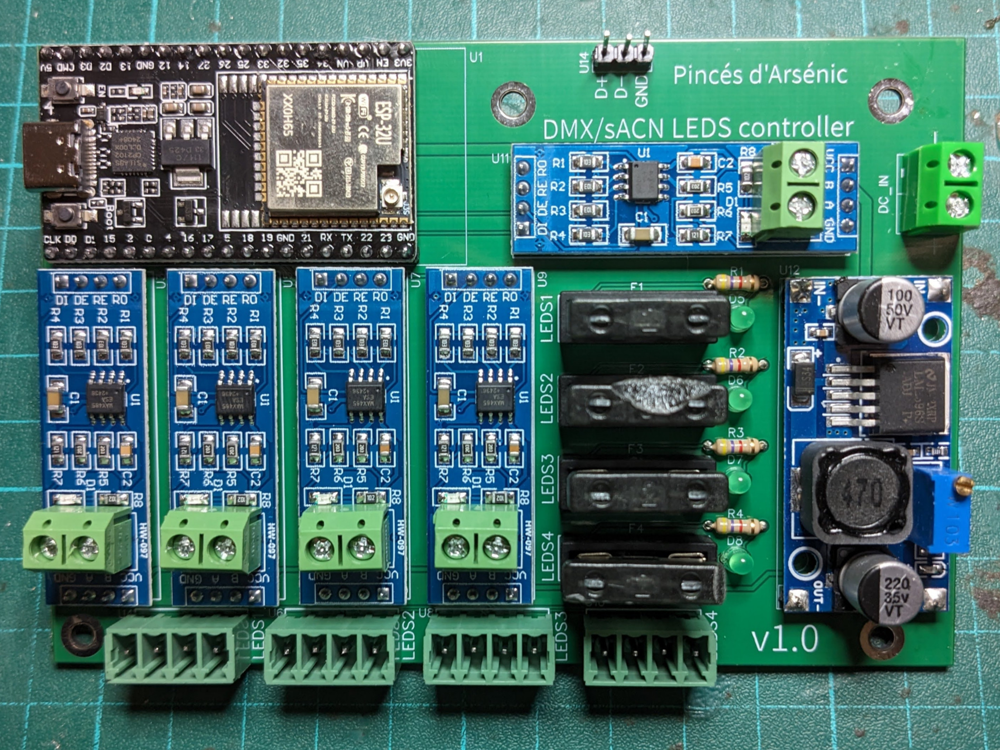

La carte électronique a aussi reçu un petit rafraichissement avec :

- Une disposition revue pour rassembler les fusibles au même endroit
- Des indicateurs d'état de fusible
- Des borniers pour les connecteurs EtherCon
- Une forme plus compacte

## Les socles

Je ne vais pas vous cacher que la solution du [youtubeur](https://www.youtube.com/@SuperValidDesigns) que je cite dans le premier article m'a beaucoup inspirée pour la conception des nouveaux socles.

Mais je vais également conserver ce que j'avais réalisé lors de la première version : le lestage avec du béton.

Mes socles seront donc :

- Pourvus d'un compartiment pour la partie électronique
- Pourvus d'une prise EtherCon
- Muni d'un dispositif de connexion/déconnexion rapide avec le tube LED.
- Conçu pour être imprimés en 3D sur un plateau de 250x250x250mm sans le recours à des supports pour minimiser la consommation de plastique et la main d’œuvre post impression.

Après de nombreuses heures derrière le logiciel de CAO, j'obtiens quelque chose qui devrait répondre à tous ces besoins.

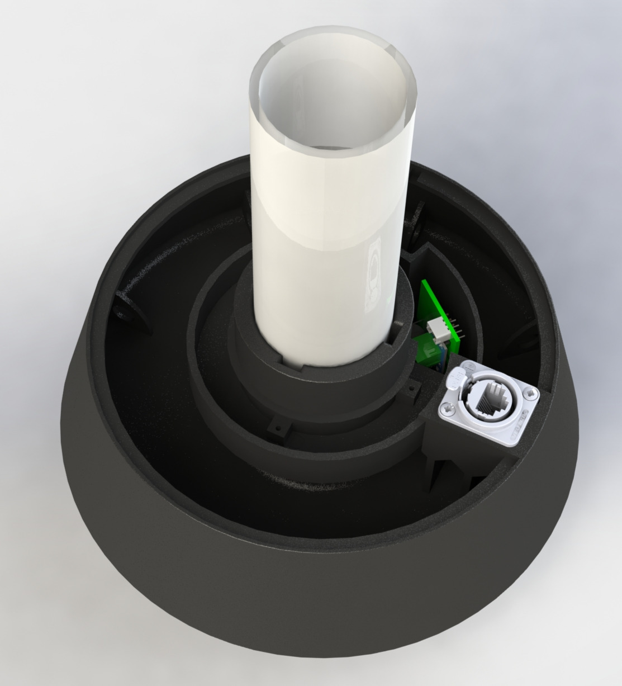

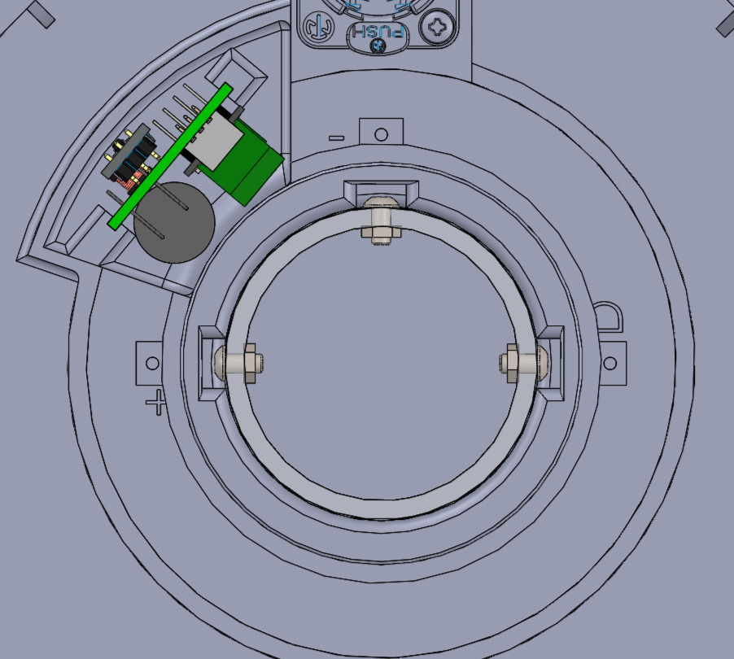



Après 24h d'impression, le résultat est plus que satisfaisant !

Le temps venant à manquer et parce que mon imprimante 3D commence à montrer des signes de faiblesse, j'imprime en PLA en sachant pertinemment qu'il aurait été préférable de choisir un plastique type ABS ou ASA (PETG à minima) pour des pièces plus robustes.

Peut-être une évolution pour la version 3 ?



J'imprime un bout de tube afin de simuler la bonne connexion des poteaux avec le socle

Le triangle permet de créer un détrompage. De cette façon, les connexions électriques seront toujours respectées.

Le test révèle que la forme des languettes devra être ajustée pour que le seul poids des poteaux assurent une connexion électrique fiable.

Dans la vidéo ci-contre, celles-ci sont trop rigides et repoussent le tube vers l'extérieur.

Les tubes sont modifiés pour la connexion rapide en raccordant les 3 fils à des vis en laiton (meilleure conduction électrique) pendant que les socles sont équipées de languettes récupérées sur de vieilles prises téléphoniques.

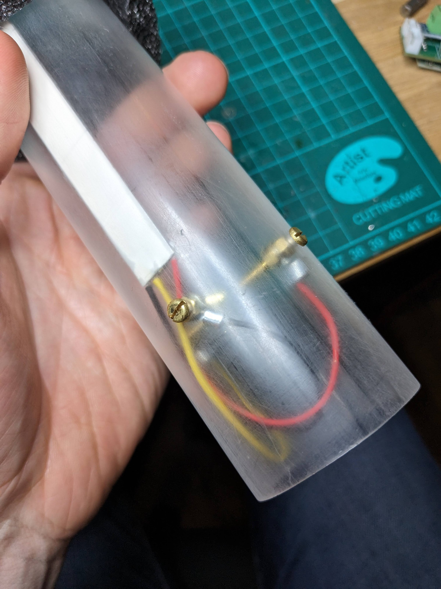

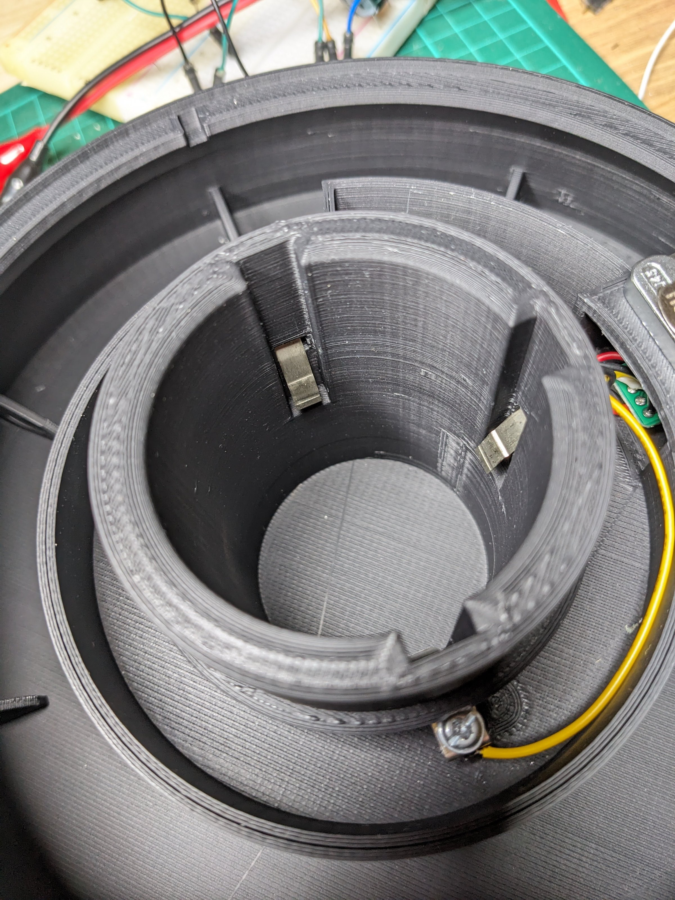

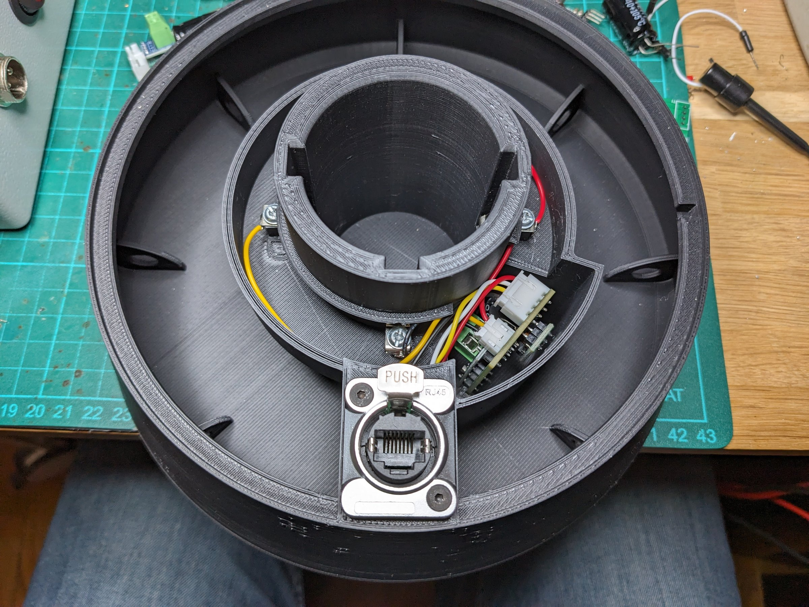

Après un test pour chaque socle, je les prépare à l'opération finale : couler le béton.

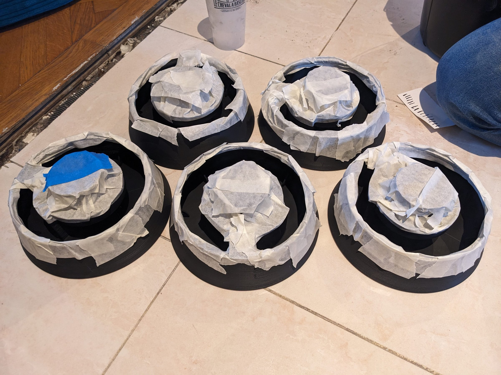

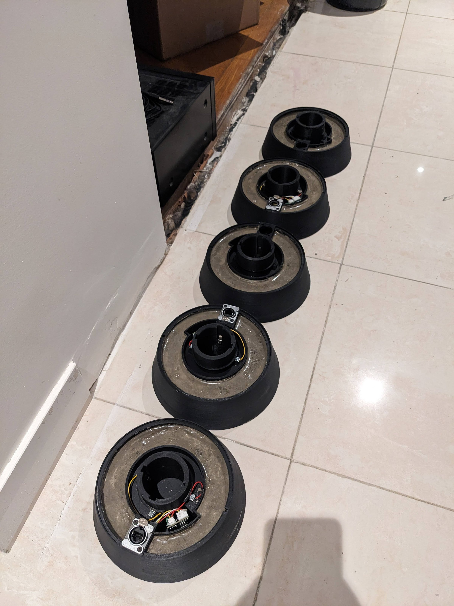

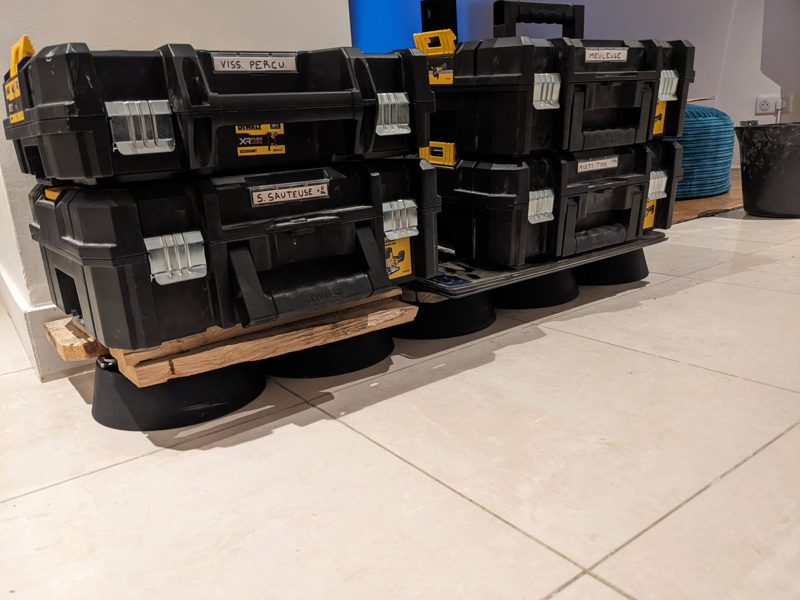

Nous sommes maintenant au soir de la veille de partir au festival avec ces poteaux, deuxième version.

Les derniers couvercles s'impriment, je ne résiste pas à un dernier test avec tous les poteaux.



## Conclusion

La version 2 m'aura donné bien du fil à retordre !

Mais le résultat est au delà de mes attentes initiales.

Le principe de connexion rapide ainsi que les câbles détachables simplifient énormément le transport.

Le système est maintenant fiable et robuste... et fini juste à temps (l'impression du dernier couvercle s'est terminée à minuit pour un départ le lendemain matin à 8h. Fiou !).

La leçon à retenir est que je n'ai pas remis en cause le câble initial alors que beaucoup de signes (et signaux sur l'oscilloscope) l'incriminaient. Cela m'a fait perdre un temps précieux.

Enfin, je retiens que même pour un projet qui se veut le moins onéreux possible, faire l'impasse sur des composants de qualité peut revenir plus cher que du très bas de gamme.

Ce projet Poteaux lumineux aura occupé mes soirs et week-ends pendant un total de 3 mois.

Mais j'ai déjà des idées pour la suite, alors ne manquez pas les autres articles du blogs !
